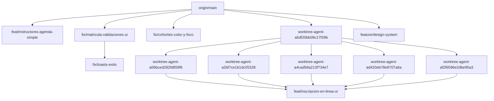

# P01 · inventario, auditoría y plan de pull requests

Estado: NO se publicó ninguna rama en P01. La publicación espera tu revisión de los candidatos de datos personales (d) y, en backend, de las coincidencias (b). No se modificaron archivos fuente, mensajes, autores, remotos ni historia. No se crearon commits, etiquetas ni PR; no se ejecutaron pruebas, builds, servidores ni SQL.

Repositorio: `/Users/lapcf051/Documents/UNI/coloradosdrive/coloradosdrive-frontend`. Rama conservada: `feat/inscripcion-en-linea-ui`; HEAD `b8e79f20f2e3b5904f57f45a172eea32c8dfd20b`.
Inventario basado en refs locales origin/*, sin fetch ni consulta de red en P01. No se afirma que reflejen cambios remotos posteriores al último fetch. Antes de cualquier publicación se debe actualizar y comprobar las refs; si hay rechazo o historia distinta, detenerse sin forzar.

## Remoto y autores

```text
origin	https://github.com/ErickG11/coloradosdrive-frontend.git (fetch)
origin	https://github.com/ErickG11/coloradosdrive-frontend.git (push)
```
El propietario configurado es ErickG11 y el nombre coincide con el repositorio esperado; no apunta al namespace de otro usuario. Esto verifica la configuración local, no consulta el estado de fork en GitHub.

Autores distintos de los commits revisados (sin cambios):

- ErickG11 <grandaerick8@gmail.com>
- JohaoG10 <johao.gavilanes@udla.edu.ec>

Stashes: ninguno en ambos repos. El árbol tracked estaba limpio y se conserva. Los archivos sin seguimiento de progreso, deuda, contratos y .claude permanecen sin seguimiento; este plan también.

## Todas las ramas locales

| Rama | Upstream | Sobre origin/main | Solo local frente a upstream | Faltan en origin/misma-rama | Detrás de origin/main |
| --- | --- | ---: | ---: | ---: | ---: |
| `feat/cohortes-eliminar-ui` | `origin/feat/cohortes-eliminar-ui` | 0 | 0 | 0 | 50 |
| `feat/inscripcion-en-linea-ui` | `sin upstream` | 73 | 73 | 73 | 0 |
| `feat/instructores-agenda-simple` | `origin/feat/instructores-agenda-simple` | 1 | 0 | 0 | 85 |
| `feature/design-system` | `sin upstream` | 10 | 10 | 10 | 177 |
| `feature/visual-polish` | `origin/feature/visual-polish` | 0 | 0 | 0 | 133 |
| `fix/cohortes-color-y-foco` | `origin/fix/cohortes-color-y-foco` | 4 | 0 | 0 | 0 |
| `fix/cohortes-concurrencia-ui` | `origin/fix/cohortes-concurrencia-ui` | 0 | 0 | 0 | 58 |
| `fix/cohortes-formulario-ui` | `origin/fix/cohortes-formulario-ui` | 0 | 0 | 0 | 65 |
| `fix/cohortes-pantalla` | `origin/fix/cohortes-pantalla` | 0 | 0 | 0 | 55 |
| `fix/formato-moneda` | `origin/fix/formato-moneda` | 0 | 0 | 0 | 43 |
| `fix/formularios-accesibles-titulos` | `origin/fix/formularios-accesibles-titulos` | 0 | 0 | 0 | 70 |
| `fix/formularios-valores-vacios` | `origin/fix/formularios-valores-vacios` | 0 | 0 | 0 | 67 |
| `fix/login-accesibilidad-acceso` | `origin/fix/login-accesibilidad-acceso` | 0 | 0 | 0 | 81 |
| `fix/matricula-validaciones-ui` | `origin/main` | 7 | 7 | 7 | 34 |
| `fix/toasts-exito` | `origin/main` | 16 | 16 | 16 | 34 |
| `main` | `origin/main` | 0 | 0 | 0 | 0 |
| `worktree-agent-a06bced282fd859f6` | `sin upstream` | 41 | 41 | 41 | 0 |
| `worktree-agent-a2bf7ce1b1dc05328` | `sin upstream` | 40 | 40 | 40 | 0 |
| `worktree-agent-a4cad56a213f734e7` | `sin upstream` | 38 | 38 | 38 | 0 |
| `worktree-agent-a5df20bb09c17f29b` | `sin upstream` | 1 | 1 | 1 | 0 |
| `worktree-agent-ad420eb78e8707a6a` | `sin upstream` | 40 | 40 | 40 | 0 |
| `worktree-agent-af2f6596e2dbe95a3` | `sin upstream` | 40 | 40 | 40 | 0 |

Fusionadas/ancestros de origin/main, omitidas de publicación: `feat/cohortes-eliminar-ui`, `feature/visual-polish`, `fix/cohortes-concurrencia-ui`, `fix/cohortes-formulario-ui`, `fix/cohortes-pantalla`, `fix/formato-moneda`, `fix/formularios-accesibles-titulos`, `fix/formularios-valores-vacios`, `fix/login-accesibilidad-acceso`, `main`.
Los conteos no se suman: varias ramas comparten commits. Los checkpoints de worktree son ramas locales reales; no se borran ni se renombran. Las ramas con cero commits frente a su remoto ya están publicadas y no se vuelven a empujar.

## Ancestros, puntas y orden

Relaciones comprobadas con merge-base; no se inventa una cadena lineal entre ramas divergentes.



Puntas independientes: `feat/instructores-agenda-simple`, `fix/cohortes-color-y-foco`, `feature/design-system`, `fix/toasts-exito`, `feat/inscripcion-en-linea-ui`.
La punta consolidada de inscripción contiene los checkpoints correspondientes; sus PR intermedios comparten mucha historia. Si se abren por separado sobre main, se solaparán: revisar los diffs y el orden antes de fusionar. P01 no fusiona ni resuelve divergencias.

Orden de publicación propuesto (solo tras desbloqueo):

1. `worktree-agent-a5df20bb09c17f29b`
2. `fix/matricula-validaciones-ui`
3. `feature/design-system`
4. `fix/toasts-exito`
5. `worktree-agent-a4cad56a213f734e7`
6. `worktree-agent-a2bf7ce1b1dc05328`
7. `worktree-agent-ad420eb78e8707a6a`
8. `worktree-agent-af2f6596e2dbe95a3`
9. `worktree-agent-a06bced282fd859f6`
10. `feat/inscripcion-en-linea-ui`

Backend completo primero; frontend después. Las líneas independientes pueden revisarse por separado; todos los ancestros nombrados van antes de sus descendientes.

## Resultado de los escaneos

Se revisaron 104 commits únicos y 50229 líneas añadidas, incluyendo commits intermedios y cambios luego retirados; 453 rutas en git ls-files del checkout actual, árboles de cada rama pendiente y blobs de todo el historial nuevo.

a) Mensajes: 0 coincidencias de Co-Authored-By, Claude, Codex, GPT, Generated with, IA/AI o equivalentes. No se modificaron mensajes.
b) Secretos: 0 coincidencias para revisión. JWT, sb_secret/sk_, AKIA, PRIVATE KEY, credenciales de conexión y asignaciones de contraseña/secreto se buscaron en las adiciones de cada commit, no solo en el diff final.
c) Rutas prohibidas trackeadas: 0; rutas intermedias prohibidas: 0; archivos actuales >5 MB (5.000.000 bytes): 0; blobs históricos nuevos >5 MB (5.000.000 bytes): 0. .env.example y plantillas equivalentes se separan como ejemplos, con valores revisados por b).
No se encontraron credenciales reales verificadas; esto no es una garantía de ausencia de secretos. Las coincidencias b) no se descartan automáticamente por estar en tests o documentación. Los nombres service_role de roles SQL no son claves: 0 referencias añadidas revisadas como identificadores de rol, además de buscar tokens y valores de claves.

### b) Coincidencias, sin reproducir posibles secretos

| Commit | Archivo:línea del commit | Patrón | Revisión de contexto |
| --- | --- | --- | --- |
| — | — | Sin coincidencias | — |

### Cobertura real de exclusiones

Comprobación git check-ignore --no-index -v en la rama conservada. También se leyó .gitignore en cada rama local; las instantáneas más antiguas pueden tener menos reglas. No se añadió ninguna exclusión ni se afirmó cobertura donde falta. Gitignore no puede excluir genéricamente por tamaño.

| Ruta de control | Resultado/fuente |
| --- | --- |
| `.env` | .gitignore:13:.env	.env |
| `.env.local` | .gitignore:14:.env.local	.env.local |
| `keys/private.pem` | NO CUBIERTO |
| `keys/private.key` | NO CUBIERTO |
| `.auth/admin.json` | NO CUBIERTO |
| `storageState.json` | NO CUBIERTO |
| `node_modules/x` | .gitignore:2:node_modules/	node_modules/x |
| `.next/x` | .gitignore:5:.next/	.next/x |
| `coverage/x` | .gitignore:18:coverage/	coverage/x |
| `playwright-report/x` | NO CUBIERTO |
| `test-results/x` | NO CUBIERTO |
| `.agents/x` | .gitignore:45:.agents/	.agents/x |
| `.codex/x` | .gitignore:46:.codex/	.codex/x |
| `.claude/x` | NO CUBIERTO |
| `.impeccable/x` | .gitignore:48:.impeccable/	.impeccable/x |
| `.taste-skill/x` | .gitignore:52:.taste-skill/	.taste-skill/x |
| `.github/skills/x` | .gitignore:49:.github/skills/	.github/skills/x |
| `.github/agents/x` | .gitignore:50:.github/agents/	.github/agents/x |
| `.github/hooks/x` | .gitignore:51:.github/hooks/	.github/hooks/x |

### d) Candidatos de datos personales

Se informa una detección heurística, no se afirma que los ejemplos sean identidades reales. Incluye cédulas posibles (con/sin checksum), teléfonos09, correos en dominios enrutables y nombres en campos/literales/prosa. Hay falsos positivos de textos UI, cursos, instituciones, timestamps y plantillas; quedan identificados para tu decisión. Los ejemplos no se borraron ni censuraron en sus fuentes. Se separa árbol final e historial para no ocultar datos retirados de una punta pero conservados en commits públicos.
No se empuja ninguna rama pendiente hasta tu decisión sobre d), incluso si un dato parece ficticio o ya estaba en main.

| Rama | a mensajes | b coincidencias | c track/objetos | d árbol final | d historial añadido | Publicación P01 |
| --- | ---: | ---: | ---: | ---: | ---: | --- |
| `feat/instructores-agenda-simple` | 0 | 0 | 0 | 81 | 2 | No: ya estaba publicada |
| `worktree-agent-a5df20bb09c17f29b` | 0 | 0 | 0 | 111 | 0 | No: d pendiente |
| `fix/cohortes-color-y-foco` | 0 | 0 | 0 | 111 | 0 | No: ya estaba publicada |
| `fix/matricula-validaciones-ui` | 0 | 0 | 0 | 114 | 17 | No: d pendiente |
| `feature/design-system` | 0 | 0 | 0 | 15 | 0 | No: d pendiente |
| `fix/toasts-exito` | 0 | 0 | 0 | 115 | 23 | No: d pendiente |
| `worktree-agent-a4cad56a213f734e7` | 0 | 0 | 0 | 135 | 69 | No: d pendiente |
| `worktree-agent-a2bf7ce1b1dc05328` | 0 | 0 | 0 | 135 | 69 | No: d pendiente |
| `worktree-agent-ad420eb78e8707a6a` | 0 | 0 | 0 | 137 | 71 | No: d pendiente |
| `worktree-agent-af2f6596e2dbe95a3` | 0 | 0 | 0 | 137 | 71 | No: d pendiente |
| `worktree-agent-a06bced282fd859f6` | 0 | 0 | 0 | 135 | 69 | No: d pendiente |
| `feat/inscripcion-en-linea-ui` | 0 | 0 | 0 | 139 | 85 | No: d pendiente |

## Hallazgos d en árboles finales · listado completo

266 posiciones/valores/versiones agrupadas; las ramas compartidas se enumeran. Commit es la procedencia de la línea según git blame, no un nuevo commit de P01.

| Archivo:línea | Tipo y valor | Commit de línea | Clasificación provisional | Ramas |
| --- | --- | --- | --- | --- |
| `app/(admin)/admin/enrollments/wizard/StepDatosEstudiante.tsx:142` | Correo de dominio real: `nombre@correo.com` | `74411a9` | dominio enrutable; real/ficticio/propiedad por confirmar | `feat/inscripcion-en-linea-ui`, `fix/cohortes-color-y-foco`, `worktree-agent-a06bced282fd859f6`, `worktree-agent-a2bf7ce1b1dc05328`, `worktree-agent-a4cad56a213f734e7`, `worktree-agent-a5df20bb09c17f29b`, `worktree-agent-ad420eb78e8707a6a`, `worktree-agent-af2f6596e2dbe95a3` |
| `app/(admin)/admin/enrollments/wizard/validation.ts:18` | Nombre en campo: `El nombre completo debe incluir letras y no puede contener números.` | `5bf189d` | nombre candidato; fixture/identidad real por confirmar | `fix/matricula-validaciones-ui`, `fix/toasts-exito` |
| `components/inscripcion/DataStep.tsx:142` | Teléfono09: `0991234567` | `3975107` | teléfono con forma ecuatoriana; ejemplo/propiedad por confirmar | `feat/inscripcion-en-linea-ui`, `worktree-agent-a06bced282fd859f6`, `worktree-agent-a2bf7ce1b1dc05328`, `worktree-agent-a4cad56a213f734e7`, `worktree-agent-ad420eb78e8707a6a`, `worktree-agent-af2f6596e2dbe95a3` |
| `components/inscripcion/pasos/PasoDatos.tsx:386` | Teléfono09: `0991234567` | `b8e79f2` | teléfono con forma ecuatoriana; ejemplo/propiedad por confirmar | `feat/inscripcion-en-linea-ui` |
| `components/inscripcion/pasos/PasoDatos.tsx:396` | Teléfono09: `0991234567` | `9ef2362` | teléfono con forma ecuatoriana; ejemplo/propiedad por confirmar | `worktree-agent-af2f6596e2dbe95a3` |
| `components/inscripcion/pasos/PasoEstudios.tsx:313` | Nombre en campo: `Arrastra tu archivo aquí o selecciónalo` | `bfb3aed` | posible texto de UI/institución/curso; no se afirma nombre personal | `worktree-agent-af2f6596e2dbe95a3` |
| `components/inscripcion/pasos/PasoEstudios.tsx:316` | Nombre en campo: `Arrastra tu archivo aquí o selecciónalo` | `bfb3aed` | posible texto de UI/institución/curso; no se afirma nombre personal | `feat/inscripcion-en-linea-ui` |
| `lib/api/studentProfile.ts:5` | Nombre en campo: `Nombre completo` | `a6029e2` | posible texto de UI/institución/curso; no se afirma nombre personal | `feat/inscripcion-en-linea-ui`, `feat/instructores-agenda-simple`, `fix/cohortes-color-y-foco`, `worktree-agent-a06bced282fd859f6`, `worktree-agent-a2bf7ce1b1dc05328`, `worktree-agent-a4cad56a213f734e7`, `worktree-agent-a5df20bb09c17f29b`, `worktree-agent-ad420eb78e8707a6a`, `worktree-agent-af2f6596e2dbe95a3` |
| `lib/api/studentProfile.ts:7` | Nombre en campo: `Nombre completo` | `a6029e2` | posible texto de UI/institución/curso; no se afirma nombre personal | `fix/matricula-validaciones-ui`, `fix/toasts-exito` |
| `lib/content/landing.ts:9` | Teléfono09: `0992042546` | `c08d490` | teléfono con forma ecuatoriana; ejemplo/propiedad por confirmar | `feat/inscripcion-en-linea-ui`, `fix/cohortes-color-y-foco`, `worktree-agent-a06bced282fd859f6`, `worktree-agent-a2bf7ce1b1dc05328`, `worktree-agent-a4cad56a213f734e7`, `worktree-agent-a5df20bb09c17f29b`, `worktree-agent-ad420eb78e8707a6a`, `worktree-agent-af2f6596e2dbe95a3` |
| `lib/content/landing.ts:10` | Teléfono09: `0997913888` | `c08d490` | teléfono con forma ecuatoriana; ejemplo/propiedad por confirmar | `feat/inscripcion-en-linea-ui`, `fix/cohortes-color-y-foco`, `worktree-agent-a06bced282fd859f6`, `worktree-agent-a2bf7ce1b1dc05328`, `worktree-agent-a4cad56a213f734e7`, `worktree-agent-a5df20bb09c17f29b`, `worktree-agent-ad420eb78e8707a6a`, `worktree-agent-af2f6596e2dbe95a3` |
| `lib/content/verificacion-links.ts:11` | Nombre en campo: `Ministerio de Educación` | `ef6683d` | posible texto de UI/institución/curso; no se afirma nombre personal | `feat/inscripcion-en-linea-ui`, `worktree-agent-ad420eb78e8707a6a` |
| `lib/content/verificacion-links.ts:19` | Nombre en campo: `Registro Civil` | `ef6683d` | posible texto de UI/institución/curso; no se afirma nombre personal | `feat/inscripcion-en-linea-ui`, `worktree-agent-ad420eb78e8707a6a` |
| `tests/app/(admin)/admin/cohorts/CohortForm.test.tsx:38` | Nombre en campo: `Vehículos livianos` | `050e5aa` | posible texto de UI/institución/curso; no se afirma nombre personal | `feat/instructores-agenda-simple`, `feature/design-system` |
| `tests/app/(admin)/admin/cohorts/CohortForm.test.tsx:39` | Nombre en campo: `Vehículos livianos` | `050e5aa` | posible texto de UI/institución/curso; no se afirma nombre personal | `feat/inscripcion-en-linea-ui`, `fix/cohortes-color-y-foco`, `fix/matricula-validaciones-ui`, `worktree-agent-a06bced282fd859f6`, `worktree-agent-a2bf7ce1b1dc05328`, `worktree-agent-a4cad56a213f734e7`, `worktree-agent-a5df20bb09c17f29b`, `worktree-agent-ad420eb78e8707a6a`, `worktree-agent-af2f6596e2dbe95a3` |
| `tests/app/(admin)/admin/cohorts/CohortForm.test.tsx:42` | Nombre en campo: `Vehículos livianos` | `050e5aa` | posible texto de UI/institución/curso; no se afirma nombre personal | `fix/toasts-exito` |
| `tests/app/(admin)/admin/cohorts/CohortForm.test.tsx:84` | Nombre en campo: `Cohorte Marzo` | `050e5aa` | posible texto de UI/institución/curso; no se afirma nombre personal | `feature/design-system` |
| `tests/app/(admin)/admin/cohorts/CohortForm.test.tsx:96` | Nombre en campo: `Cohorte Marzo` | `050e5aa` | posible texto de UI/institución/curso; no se afirma nombre personal | `feat/instructores-agenda-simple` |
| `tests/app/(admin)/admin/cohorts/CohortForm.test.tsx:103` | Nombre en campo: `Cohorte Julio` | `050e5aa` | posible texto de UI/institución/curso; no se afirma nombre personal | `feature/design-system` |
| `tests/app/(admin)/admin/cohorts/CohortForm.test.tsx:107` | Nombre en campo: `Cohorte Marzo` | `050e5aa` | posible texto de UI/institución/curso; no se afirma nombre personal | `feat/inscripcion-en-linea-ui`, `fix/matricula-validaciones-ui`, `worktree-agent-a06bced282fd859f6`, `worktree-agent-a2bf7ce1b1dc05328`, `worktree-agent-a4cad56a213f734e7`, `worktree-agent-a5df20bb09c17f29b`, `worktree-agent-ad420eb78e8707a6a`, `worktree-agent-af2f6596e2dbe95a3` |
| `tests/app/(admin)/admin/cohorts/CohortForm.test.tsx:110` | Nombre en campo: `Cohorte Marzo` | `050e5aa` | posible texto de UI/institución/curso; no se afirma nombre personal | `fix/toasts-exito` |
| `tests/app/(admin)/admin/cohorts/CohortForm.test.tsx:120` | Nombre en campo: `Cohorte Julio` | `050e5aa` | posible texto de UI/institución/curso; no se afirma nombre personal | `feature/design-system` |
| `tests/app/(admin)/admin/cohorts/CohortForm.test.tsx:137` | Nombre en campo: `Cohorte Marzo` | `050e5aa` | posible texto de UI/institución/curso; no se afirma nombre personal | `fix/cohortes-color-y-foco` |
| `tests/app/(admin)/admin/cohorts/CohortForm.test.tsx:170` | Nombre en campo: `Cohorte Julio` | `050e5aa` | posible texto de UI/institución/curso; no se afirma nombre personal | `feat/instructores-agenda-simple` |
| `tests/app/(admin)/admin/cohorts/CohortForm.test.tsx:193` | Nombre en campo: `Cohorte Julio` | `050e5aa` | posible texto de UI/institución/curso; no se afirma nombre personal | `feat/instructores-agenda-simple` |
| `tests/app/(admin)/admin/cohorts/CohortForm.test.tsx:244` | Nombre en campo: `Cohorte Julio` | `050e5aa` | posible texto de UI/institución/curso; no se afirma nombre personal | `feat/inscripcion-en-linea-ui`, `fix/matricula-validaciones-ui`, `worktree-agent-a06bced282fd859f6`, `worktree-agent-a2bf7ce1b1dc05328`, `worktree-agent-a4cad56a213f734e7`, `worktree-agent-a5df20bb09c17f29b`, `worktree-agent-ad420eb78e8707a6a`, `worktree-agent-af2f6596e2dbe95a3` |
| `tests/app/(admin)/admin/cohorts/CohortForm.test.tsx:249` | Nombre en campo: `Cohorte Julio` | `050e5aa` | posible texto de UI/institución/curso; no se afirma nombre personal | `fix/toasts-exito` |
| `tests/app/(admin)/admin/cohorts/CohortForm.test.tsx:270` | Nombre en campo: `Cohorte Julio B` | `56491b1` | posible texto de UI/institución/curso; no se afirma nombre personal | `feat/inscripcion-en-linea-ui`, `fix/matricula-validaciones-ui`, `worktree-agent-a06bced282fd859f6`, `worktree-agent-a2bf7ce1b1dc05328`, `worktree-agent-a4cad56a213f734e7`, `worktree-agent-a5df20bb09c17f29b`, `worktree-agent-ad420eb78e8707a6a`, `worktree-agent-af2f6596e2dbe95a3` |
| `tests/app/(admin)/admin/cohorts/CohortForm.test.tsx:275` | Nombre en campo: `Cohorte Julio B` | `56491b1` | posible texto de UI/institución/curso; no se afirma nombre personal | `fix/toasts-exito` |
| `tests/app/(admin)/admin/cohorts/CohortForm.test.tsx:316` | Nombre en campo: `Cohorte Julio` | `050e5aa` | posible texto de UI/institución/curso; no se afirma nombre personal | `fix/cohortes-color-y-foco` |
| `tests/app/(admin)/admin/cohorts/CohortForm.test.tsx:342` | Nombre en campo: `Cohorte Julio B` | `56491b1` | posible texto de UI/institución/curso; no se afirma nombre personal | `fix/cohortes-color-y-foco` |
| `tests/app/(admin)/admin/cohorts/CohortForm.test.tsx:356` | Nombre en campo: `Cohorte Julio` | `bddfdfe` | posible texto de UI/institución/curso; no se afirma nombre personal | `feat/inscripcion-en-linea-ui`, `fix/matricula-validaciones-ui`, `worktree-agent-a06bced282fd859f6`, `worktree-agent-a2bf7ce1b1dc05328`, `worktree-agent-a4cad56a213f734e7`, `worktree-agent-a5df20bb09c17f29b`, `worktree-agent-ad420eb78e8707a6a`, `worktree-agent-af2f6596e2dbe95a3` |
| `tests/app/(admin)/admin/cohorts/CohortForm.test.tsx:361` | Nombre en campo: `Cohorte Julio` | `bddfdfe` | posible texto de UI/institución/curso; no se afirma nombre personal | `fix/toasts-exito` |
| `tests/app/(admin)/admin/cohorts/CohortForm.test.tsx:428` | Nombre en campo: `Cohorte Julio` | `bddfdfe` | posible texto de UI/institución/curso; no se afirma nombre personal | `fix/cohortes-color-y-foco` |
| `tests/app/(admin)/admin/cohorts/CohortForm.test.tsx:578` | Nombre en campo: `Cohorte Julio` | `f0cf784` | posible texto de UI/institución/curso; no se afirma nombre personal | `feat/inscripcion-en-linea-ui`, `fix/matricula-validaciones-ui`, `worktree-agent-a06bced282fd859f6`, `worktree-agent-a2bf7ce1b1dc05328`, `worktree-agent-a4cad56a213f734e7`, `worktree-agent-a5df20bb09c17f29b`, `worktree-agent-ad420eb78e8707a6a`, `worktree-agent-af2f6596e2dbe95a3` |
| `tests/app/(admin)/admin/cohorts/CohortForm.test.tsx:583` | Nombre en campo: `Cohorte Julio` | `f0cf784` | posible texto de UI/institución/curso; no se afirma nombre personal | `fix/toasts-exito` |
| `tests/app/(admin)/admin/cohorts/CohortForm.test.tsx:650` | Nombre en campo: `Cohorte Julio` | `f0cf784` | posible texto de UI/institución/curso; no se afirma nombre personal | `fix/cohortes-color-y-foco` |
| `tests/app/(admin)/admin/cohorts/CohortForm.test.tsx:679` | Nombre en campo: `Cohorte Julio` | `f0cf784` | posible texto de UI/institución/curso; no se afirma nombre personal | `feat/inscripcion-en-linea-ui`, `fix/matricula-validaciones-ui`, `worktree-agent-a06bced282fd859f6`, `worktree-agent-a2bf7ce1b1dc05328`, `worktree-agent-a4cad56a213f734e7`, `worktree-agent-a5df20bb09c17f29b`, `worktree-agent-ad420eb78e8707a6a`, `worktree-agent-af2f6596e2dbe95a3` |
| `tests/app/(admin)/admin/cohorts/CohortForm.test.tsx:683` | Nombre en campo: `Cohorte Julio` | `f0cf784` | posible texto de UI/institución/curso; no se afirma nombre personal | `fix/toasts-exito` |
| `tests/app/(admin)/admin/cohorts/CohortForm.test.tsx:751` | Nombre en campo: `Cohorte Julio` | `f0cf784` | posible texto de UI/institución/curso; no se afirma nombre personal | `fix/cohortes-color-y-foco` |
| `tests/app/(admin)/admin/cohorts/CohortForm.test.tsx:849` | Nombre en campo: `Cohorte Julio` | `56491b1` | posible texto de UI/institución/curso; no se afirma nombre personal | `feat/inscripcion-en-linea-ui`, `fix/matricula-validaciones-ui`, `worktree-agent-a06bced282fd859f6`, `worktree-agent-a2bf7ce1b1dc05328`, `worktree-agent-a4cad56a213f734e7`, `worktree-agent-a5df20bb09c17f29b`, `worktree-agent-ad420eb78e8707a6a`, `worktree-agent-af2f6596e2dbe95a3` |
| `tests/app/(admin)/admin/cohorts/CohortForm.test.tsx:853` | Nombre en campo: `Cohorte Julio` | `56491b1` | posible texto de UI/institución/curso; no se afirma nombre personal | `fix/toasts-exito` |
| `tests/app/(admin)/admin/cohorts/CohortForm.test.tsx:921` | Nombre en campo: `Cohorte Julio` | `56491b1` | posible texto de UI/institución/curso; no se afirma nombre personal | `fix/cohortes-color-y-foco` |
| `tests/app/(admin)/admin/cohorts/CohortForm.test.tsx:998` | Nombre en campo: `Cohorte Julio` | `2b8aa0b` | posible texto de UI/institución/curso; no se afirma nombre personal | `feat/inscripcion-en-linea-ui`, `fix/matricula-validaciones-ui`, `worktree-agent-a06bced282fd859f6`, `worktree-agent-a2bf7ce1b1dc05328`, `worktree-agent-a4cad56a213f734e7`, `worktree-agent-a5df20bb09c17f29b`, `worktree-agent-ad420eb78e8707a6a`, `worktree-agent-af2f6596e2dbe95a3` |
| `tests/app/(admin)/admin/cohorts/CohortForm.test.tsx:1003` | Nombre en campo: `Cohorte Julio` | `2b8aa0b` | posible texto de UI/institución/curso; no se afirma nombre personal | `fix/toasts-exito` |
| `tests/app/(admin)/admin/cohorts/CohortForm.test.tsx:1070` | Nombre en campo: `Cohorte Julio` | `2b8aa0b` | posible texto de UI/institución/curso; no se afirma nombre personal | `fix/cohortes-color-y-foco` |
| `tests/app/(admin)/admin/cohorts/CohortsWorkspace.test.tsx:25` | Nombre en campo: `Cohorte Marzo` | `0a94728` | posible texto de UI/institución/curso; no se afirma nombre personal | `feat/inscripcion-en-linea-ui`, `fix/cohortes-color-y-foco`, `worktree-agent-a06bced282fd859f6`, `worktree-agent-a2bf7ce1b1dc05328`, `worktree-agent-a4cad56a213f734e7`, `worktree-agent-a5df20bb09c17f29b`, `worktree-agent-ad420eb78e8707a6a`, `worktree-agent-af2f6596e2dbe95a3` |
| `tests/app/(admin)/admin/cohorts/CohortsWorkspace.test.tsx:101` | Nombre en campo: `Cohorte Marzo B` | `0a94728` | posible texto de UI/institución/curso; no se afirma nombre personal | `feat/inscripcion-en-linea-ui`, `worktree-agent-a06bced282fd859f6`, `worktree-agent-a2bf7ce1b1dc05328`, `worktree-agent-a4cad56a213f734e7`, `worktree-agent-a5df20bb09c17f29b`, `worktree-agent-ad420eb78e8707a6a`, `worktree-agent-af2f6596e2dbe95a3` |
| `tests/app/(admin)/admin/cohorts/CohortsWorkspace.test.tsx:120` | Nombre en campo: `Cohorte Marzo B` | `0a94728` | posible texto de UI/institución/curso; no se afirma nombre personal | `fix/cohortes-color-y-foco` |
| `tests/app/(admin)/admin/cohorts/DeleteCohortModal.test.tsx:20` | Nombre en campo: `Cohorte Marzo 2026` | `9936f61` | posible texto de UI/institución/curso; no se afirma nombre personal | `feat/inscripcion-en-linea-ui`, `fix/cohortes-color-y-foco`, `fix/matricula-validaciones-ui`, `fix/toasts-exito`, `worktree-agent-a06bced282fd859f6`, `worktree-agent-a2bf7ce1b1dc05328`, `worktree-agent-a4cad56a213f734e7`, `worktree-agent-a5df20bb09c17f29b`, `worktree-agent-ad420eb78e8707a6a`, `worktree-agent-af2f6596e2dbe95a3` |
| `tests/app/(admin)/admin/cohorts/DeleteCohortModal.test.tsx:90` | Nombre en campo: `Cohorte Matrícula` | `9936f61` | posible texto de UI/institución/curso; no se afirma nombre personal | `feat/inscripcion-en-linea-ui`, `fix/cohortes-color-y-foco`, `fix/matricula-validaciones-ui`, `fix/toasts-exito`, `worktree-agent-a06bced282fd859f6`, `worktree-agent-a2bf7ce1b1dc05328`, `worktree-agent-a4cad56a213f734e7`, `worktree-agent-a5df20bb09c17f29b`, `worktree-agent-ad420eb78e8707a6a`, `worktree-agent-af2f6596e2dbe95a3` |
| `tests/app/(admin)/admin/cohorts/DeleteCohortModal.test.tsx:110` | Nombre en campo: `Cohorte Marzo 2026` | `9936f61` | posible texto de UI/institución/curso; no se afirma nombre personal | `feat/inscripcion-en-linea-ui`, `fix/cohortes-color-y-foco`, `fix/matricula-validaciones-ui`, `fix/toasts-exito`, `worktree-agent-a06bced282fd859f6`, `worktree-agent-a2bf7ce1b1dc05328`, `worktree-agent-a4cad56a213f734e7`, `worktree-agent-a5df20bb09c17f29b`, `worktree-agent-ad420eb78e8707a6a`, `worktree-agent-af2f6596e2dbe95a3` |
| `tests/app/(admin)/admin/cohorts/DeleteCohortModal.test.tsx:207` | Nombre en campo: `Cohorte Marzo 2026` | `ae3a351` | posible texto de UI/institución/curso; no se afirma nombre personal | `feat/inscripcion-en-linea-ui`, `fix/cohortes-color-y-foco`, `fix/matricula-validaciones-ui`, `fix/toasts-exito`, `worktree-agent-a06bced282fd859f6`, `worktree-agent-a2bf7ce1b1dc05328`, `worktree-agent-a4cad56a213f734e7`, `worktree-agent-a5df20bb09c17f29b`, `worktree-agent-ad420eb78e8707a6a`, `worktree-agent-af2f6596e2dbe95a3` |
| `tests/app/(admin)/admin/cohorts/[id]/edit/page.test.tsx:40` | Nombre en campo: `Vehículos livianos` | `934f3c7` | posible texto de UI/institución/curso; no se afirma nombre personal | `feat/inscripcion-en-linea-ui`, `fix/cohortes-color-y-foco`, `fix/matricula-validaciones-ui`, `fix/toasts-exito`, `worktree-agent-a06bced282fd859f6`, `worktree-agent-a2bf7ce1b1dc05328`, `worktree-agent-a4cad56a213f734e7`, `worktree-agent-a5df20bb09c17f29b`, `worktree-agent-ad420eb78e8707a6a`, `worktree-agent-af2f6596e2dbe95a3` |
| `tests/app/(admin)/admin/cohorts/[id]/edit/page.test.tsx:205` | Nombre en campo: `400 editado por otra persona` | `87de706` | nombre candidato; fixture/identidad real por confirmar | `feat/inscripcion-en-linea-ui`, `fix/cohortes-color-y-foco`, `fix/matricula-validaciones-ui`, `fix/toasts-exito`, `worktree-agent-a06bced282fd859f6`, `worktree-agent-a2bf7ce1b1dc05328`, `worktree-agent-a4cad56a213f734e7`, `worktree-agent-a5df20bb09c17f29b`, `worktree-agent-ad420eb78e8707a6a`, `worktree-agent-af2f6596e2dbe95a3` |
| `tests/app/(admin)/admin/cohorts/page.test.tsx:18` | Nombre en campo: `Cohorte Marzo` | `050e5aa` | posible texto de UI/institución/curso; no se afirma nombre personal | `feat/instructores-agenda-simple`, `feature/design-system` |
| `tests/app/(admin)/admin/cohorts/page.test.tsx:27` | Nombre en campo: `Cohorte Marzo` | `050e5aa` | posible texto de UI/institución/curso; no se afirma nombre personal | `fix/toasts-exito` |
| `tests/app/(admin)/admin/cohorts/page.test.tsx:29` | Nombre en campo: `Cohorte Marzo` | `050e5aa` | posible texto de UI/institución/curso; no se afirma nombre personal | `feat/inscripcion-en-linea-ui`, `fix/cohortes-color-y-foco`, `fix/matricula-validaciones-ui`, `worktree-agent-a06bced282fd859f6`, `worktree-agent-a2bf7ce1b1dc05328`, `worktree-agent-a4cad56a213f734e7`, `worktree-agent-a5df20bb09c17f29b`, `worktree-agent-ad420eb78e8707a6a`, `worktree-agent-af2f6596e2dbe95a3` |
| `tests/app/(admin)/admin/cohorts/page.test.tsx:126` | Nombre en campo: `Cohorte Abril` | `b28f0d3` | posible texto de UI/institución/curso; no se afirma nombre personal | `fix/toasts-exito` |
| `tests/app/(admin)/admin/cohorts/page.test.tsx:127` | Nombre en campo: `Cohorte Enero` | `b28f0d3` | posible texto de UI/institución/curso; no se afirma nombre personal | `fix/toasts-exito` |
| `tests/app/(admin)/admin/cohorts/page.test.tsx:136` | Nombre en campo: `Cohorte Abril` | `b28f0d3` | posible texto de UI/institución/curso; no se afirma nombre personal | `feat/inscripcion-en-linea-ui`, `fix/cohortes-color-y-foco`, `fix/matricula-validaciones-ui`, `worktree-agent-a06bced282fd859f6`, `worktree-agent-a2bf7ce1b1dc05328`, `worktree-agent-a4cad56a213f734e7`, `worktree-agent-a5df20bb09c17f29b`, `worktree-agent-ad420eb78e8707a6a`, `worktree-agent-af2f6596e2dbe95a3` |
| `tests/app/(admin)/admin/cohorts/page.test.tsx:137` | Nombre en campo: `Cohorte Enero` | `b28f0d3` | posible texto de UI/institución/curso; no se afirma nombre personal | `feat/inscripcion-en-linea-ui`, `fix/cohortes-color-y-foco`, `fix/matricula-validaciones-ui`, `worktree-agent-a06bced282fd859f6`, `worktree-agent-a2bf7ce1b1dc05328`, `worktree-agent-a4cad56a213f734e7`, `worktree-agent-a5df20bb09c17f29b`, `worktree-agent-ad420eb78e8707a6a`, `worktree-agent-af2f6596e2dbe95a3` |
| `tests/app/(admin)/admin/cohorts/page.test.tsx:143` | Nombre en campo: `Cohorte Abril` | `384ea0a` | posible texto de UI/institución/curso; no se afirma nombre personal | `fix/toasts-exito` |
| `tests/app/(admin)/admin/cohorts/page.test.tsx:169` | Nombre en campo: `Cohorte Marzo` | `384ea0a` | posible texto de UI/institución/curso; no se afirma nombre personal | `fix/toasts-exito` |
| `tests/app/(admin)/admin/cohorts/page.test.tsx:196` | Nombre en campo: `Cohorte Abril` | `384ea0a` | posible texto de UI/institución/curso; no se afirma nombre personal | `feat/inscripcion-en-linea-ui`, `fix/cohortes-color-y-foco`, `fix/matricula-validaciones-ui`, `worktree-agent-a06bced282fd859f6`, `worktree-agent-a2bf7ce1b1dc05328`, `worktree-agent-a4cad56a213f734e7`, `worktree-agent-a5df20bb09c17f29b`, `worktree-agent-ad420eb78e8707a6a`, `worktree-agent-af2f6596e2dbe95a3` |
| `tests/app/(admin)/admin/cohorts/page.test.tsx:218` | Nombre en campo: `Cohorte Marzo` | `9dc2485` | posible texto de UI/institución/curso; no se afirma nombre personal | `fix/toasts-exito` |
| `tests/app/(admin)/admin/cohorts/page.test.tsx:222` | Nombre en campo: `Cohorte Marzo` | `384ea0a` | posible texto de UI/institución/curso; no se afirma nombre personal | `feat/inscripcion-en-linea-ui`, `fix/cohortes-color-y-foco`, `fix/matricula-validaciones-ui`, `worktree-agent-a06bced282fd859f6`, `worktree-agent-a2bf7ce1b1dc05328`, `worktree-agent-a4cad56a213f734e7`, `worktree-agent-a5df20bb09c17f29b`, `worktree-agent-ad420eb78e8707a6a`, `worktree-agent-af2f6596e2dbe95a3` |
| `tests/app/(admin)/admin/cohorts/page.test.tsx:268` | Nombre en campo: `Cohorte Marzo` | `9dc2485` | posible texto de UI/institución/curso; no se afirma nombre personal | `feat/inscripcion-en-linea-ui`, `fix/cohortes-color-y-foco`, `fix/matricula-validaciones-ui`, `worktree-agent-a06bced282fd859f6`, `worktree-agent-a2bf7ce1b1dc05328`, `worktree-agent-a4cad56a213f734e7`, `worktree-agent-a5df20bb09c17f29b`, `worktree-agent-ad420eb78e8707a6a`, `worktree-agent-af2f6596e2dbe95a3` |
| `tests/app/(admin)/admin/cohorts/page.test.tsx:292` | Nombre en campo: `Cohorte Marzo` | `9dc2485` | posible texto de UI/institución/curso; no se afirma nombre personal | `feat/inscripcion-en-linea-ui`, `fix/cohortes-color-y-foco`, `fix/matricula-validaciones-ui`, `worktree-agent-a06bced282fd859f6`, `worktree-agent-a2bf7ce1b1dc05328`, `worktree-agent-a4cad56a213f734e7`, `worktree-agent-a5df20bb09c17f29b`, `worktree-agent-ad420eb78e8707a6a`, `worktree-agent-af2f6596e2dbe95a3` |
| `tests/app/(admin)/admin/enrollments/EnrollmentForm.test.tsx:22` | Nombre en campo: `Cohorte Marzo` | `050e5aa` | posible texto de UI/institución/curso; no se afirma nombre personal | `feature/design-system` |
| `tests/app/(admin)/admin/enrollments/EnrollmentForm.test.tsx:33` | 10dígitos: `1234567890` | `050e5aa` | secuencia de 10 dígitos; no presupone identidad real | `feature/design-system` |
| `tests/app/(admin)/admin/enrollments/EnrollmentForm.test.tsx:35` | Nombre completo candidato: `Ana Torres` | `050e5aa` | nombre candidato; fixture/identidad real por confirmar | `feature/design-system` |
| `tests/app/(admin)/admin/enrollments/EnrollmentForm.test.tsx:61` | Nombre completo candidato: `Ana Torres` | `050e5aa` | nombre candidato; fixture/identidad real por confirmar | `feature/design-system` |
| `tests/app/(admin)/admin/enrollments/EnrollmentForm.test.tsx:61` | Nombre en campo: `Ana Torres` | `050e5aa` | nombre candidato; fixture/identidad real por confirmar | `feature/design-system` |
| `tests/app/(admin)/admin/enrollments/EnrollmentForm.test.tsx:71` | 10dígitos: `1234567890` | `050e5aa` | secuencia de 10 dígitos; no presupone identidad real | `feature/design-system` |
| `tests/app/(admin)/admin/enrollments/EnrollmentForm.test.tsx:72` | Nombre completo candidato: `Ana Torres` | `050e5aa` | nombre candidato; fixture/identidad real por confirmar | `feature/design-system` |
| `tests/app/(admin)/admin/enrollments/EnrollmentForm.test.tsx:72` | Nombre en campo: `Ana Torres` | `050e5aa` | nombre candidato; fixture/identidad real por confirmar | `feature/design-system` |
| `tests/app/(admin)/admin/enrollments/wizard/EnrollmentWizard.test.tsx:11` | 10dígitos: `1710034065`; checksum EC válido | `2ed8472` | secuencia de 10 dígitos; no presupone identidad real | `fix/matricula-validaciones-ui`, `fix/toasts-exito` |
| `tests/app/(admin)/admin/enrollments/wizard/EnrollmentWizard.test.tsx:16` | Nombre en campo: `Cohorte A` | `29a35d6` | posible texto de UI/institución/curso; no se afirma nombre personal | `feat/inscripcion-en-linea-ui`, `feat/instructores-agenda-simple`, `fix/cohortes-color-y-foco`, `worktree-agent-a06bced282fd859f6`, `worktree-agent-a2bf7ce1b1dc05328`, `worktree-agent-a4cad56a213f734e7`, `worktree-agent-a5df20bb09c17f29b`, `worktree-agent-ad420eb78e8707a6a`, `worktree-agent-af2f6596e2dbe95a3` |
| `tests/app/(admin)/admin/enrollments/wizard/EnrollmentWizard.test.tsx:17` | Nombre en campo: `Cohorte A` | `29a35d6` | posible texto de UI/institución/curso; no se afirma nombre personal | `fix/matricula-validaciones-ui` |
| `tests/app/(admin)/admin/enrollments/wizard/EnrollmentWizard.test.tsx:19` | Nombre en campo: `Cohorte A` | `29a35d6` | posible texto de UI/institución/curso; no se afirma nombre personal | `fix/toasts-exito` |
| `tests/app/(admin)/admin/enrollments/wizard/EnrollmentWizard.test.tsx:52` | Nombre en campo: `Instructor local` | `29a35d6` | nombre candidato; fixture/identidad real por confirmar | `feat/inscripcion-en-linea-ui`, `feat/instructores-agenda-simple`, `fix/cohortes-color-y-foco`, `worktree-agent-a06bced282fd859f6`, `worktree-agent-a2bf7ce1b1dc05328`, `worktree-agent-a4cad56a213f734e7`, `worktree-agent-a5df20bb09c17f29b`, `worktree-agent-ad420eb78e8707a6a`, `worktree-agent-af2f6596e2dbe95a3` |
| `tests/app/(admin)/admin/enrollments/wizard/EnrollmentWizard.test.tsx:53` | Nombre en campo: `Instructor local` | `29a35d6` | nombre candidato; fixture/identidad real por confirmar | `fix/matricula-validaciones-ui` |
| `tests/app/(admin)/admin/enrollments/wizard/EnrollmentWizard.test.tsx:55` | Nombre en campo: `Instructor local` | `29a35d6` | nombre candidato; fixture/identidad real por confirmar | `fix/toasts-exito` |
| `tests/app/(admin)/admin/enrollments/wizard/EnrollmentWizard.test.tsx:101` | Nombre en campo: `Vehículos livianos` | `e6b380f` | posible texto de UI/institución/curso; no se afirma nombre personal | `feat/inscripcion-en-linea-ui`, `feat/instructores-agenda-simple`, `fix/cohortes-color-y-foco`, `worktree-agent-a06bced282fd859f6`, `worktree-agent-a2bf7ce1b1dc05328`, `worktree-agent-a4cad56a213f734e7`, `worktree-agent-a5df20bb09c17f29b`, `worktree-agent-ad420eb78e8707a6a`, `worktree-agent-af2f6596e2dbe95a3` |
| `tests/app/(admin)/admin/enrollments/wizard/EnrollmentWizard.test.tsx:102` | Nombre en campo: `Vehículos livianos` | `e6b380f` | posible texto de UI/institución/curso; no se afirma nombre personal | `fix/matricula-validaciones-ui` |
| `tests/app/(admin)/admin/enrollments/wizard/EnrollmentWizard.test.tsx:104` | Nombre en campo: `Vehículos livianos` | `e6b380f` | posible texto de UI/institución/curso; no se afirma nombre personal | `fix/toasts-exito` |
| `tests/app/(admin)/admin/enrollments/wizard/EnrollmentWizard.test.tsx:129` | Nombre en campo: `Vehículos livianos` | `e6b380f` | posible texto de UI/institución/curso; no se afirma nombre personal | `feat/inscripcion-en-linea-ui`, `feat/instructores-agenda-simple`, `fix/cohortes-color-y-foco`, `worktree-agent-a06bced282fd859f6`, `worktree-agent-a2bf7ce1b1dc05328`, `worktree-agent-a4cad56a213f734e7`, `worktree-agent-a5df20bb09c17f29b`, `worktree-agent-ad420eb78e8707a6a`, `worktree-agent-af2f6596e2dbe95a3` |
| `tests/app/(admin)/admin/enrollments/wizard/EnrollmentWizard.test.tsx:131` | Nombre en campo: `Vehículos livianos` | `e6b380f` | posible texto de UI/institución/curso; no se afirma nombre personal | `fix/matricula-validaciones-ui` |
| `tests/app/(admin)/admin/enrollments/wizard/EnrollmentWizard.test.tsx:133` | Nombre en campo: `Vehículos livianos` | `e6b380f` | posible texto de UI/institución/curso; no se afirma nombre personal | `fix/toasts-exito` |
| `tests/app/(admin)/admin/enrollments/wizard/EnrollmentWizard.test.tsx:134` | 10dígitos: `1234567890` | `e6b380f` | secuencia de 10 dígitos; no presupone identidad real | `feat/inscripcion-en-linea-ui`, `feat/instructores-agenda-simple`, `fix/cohortes-color-y-foco`, `worktree-agent-a06bced282fd859f6`, `worktree-agent-a2bf7ce1b1dc05328`, `worktree-agent-a4cad56a213f734e7`, `worktree-agent-a5df20bb09c17f29b`, `worktree-agent-ad420eb78e8707a6a`, `worktree-agent-af2f6596e2dbe95a3` |
| `tests/app/(admin)/admin/enrollments/wizard/EnrollmentWizard.test.tsx:135` | Nombre en campo: `Ana existente` | `e6b380f` | nombre candidato; fixture/identidad real por confirmar | `feat/inscripcion-en-linea-ui`, `feat/instructores-agenda-simple`, `fix/cohortes-color-y-foco`, `worktree-agent-a06bced282fd859f6`, `worktree-agent-a2bf7ce1b1dc05328`, `worktree-agent-a4cad56a213f734e7`, `worktree-agent-a5df20bb09c17f29b`, `worktree-agent-ad420eb78e8707a6a`, `worktree-agent-af2f6596e2dbe95a3` |
| `tests/app/(admin)/admin/enrollments/wizard/EnrollmentWizard.test.tsx:136` | 10dígitos: `1234567890` | `e6b380f` | secuencia de 10 dígitos; no presupone identidad real | `fix/matricula-validaciones-ui` |
| `tests/app/(admin)/admin/enrollments/wizard/EnrollmentWizard.test.tsx:137` | Nombre en campo: `Ana existente` | `e6b380f` | nombre candidato; fixture/identidad real por confirmar | `fix/matricula-validaciones-ui` |
| `tests/app/(admin)/admin/enrollments/wizard/EnrollmentWizard.test.tsx:138` | 10dígitos: `1234567890` | `e6b380f` | secuencia de 10 dígitos; no presupone identidad real | `fix/toasts-exito` |
| `tests/app/(admin)/admin/enrollments/wizard/EnrollmentWizard.test.tsx:139` | Nombre en campo: `Ana existente` | `e6b380f` | nombre candidato; fixture/identidad real por confirmar | `fix/toasts-exito` |
| `tests/app/(admin)/admin/enrollments/wizard/EnrollmentWizard.test.tsx:148` | 10dígitos: `1234567890` | `29a35d6` | secuencia de 10 dígitos; no presupone identidad real | `feat/inscripcion-en-linea-ui`, `feat/instructores-agenda-simple`, `fix/cohortes-color-y-foco`, `worktree-agent-a06bced282fd859f6`, `worktree-agent-a2bf7ce1b1dc05328`, `worktree-agent-a4cad56a213f734e7`, `worktree-agent-a5df20bb09c17f29b`, `worktree-agent-ad420eb78e8707a6a`, `worktree-agent-af2f6596e2dbe95a3` |
| `tests/app/(admin)/admin/enrollments/wizard/EnrollmentWizard.test.tsx:297` | 10dígitos: `1234567890` | `e6b380f` | secuencia de 10 dígitos; no presupone identidad real | `feat/instructores-agenda-simple` |
| `tests/app/(admin)/admin/enrollments/wizard/EnrollmentWizard.test.tsx:298` | 10dígitos: `1234567890` | `e6b380f` | secuencia de 10 dígitos; no presupone identidad real | `feat/inscripcion-en-linea-ui`, `fix/cohortes-color-y-foco`, `worktree-agent-a06bced282fd859f6`, `worktree-agent-a2bf7ce1b1dc05328`, `worktree-agent-a4cad56a213f734e7`, `worktree-agent-a5df20bb09c17f29b`, `worktree-agent-ad420eb78e8707a6a`, `worktree-agent-af2f6596e2dbe95a3` |
| `tests/app/(admin)/admin/enrollments/wizard/EnrollmentWizard.test.tsx:332` | 10dígitos: `1234567890` | `e6b380f` | secuencia de 10 dígitos; no presupone identidad real | `fix/matricula-validaciones-ui` |
| `tests/app/(admin)/admin/enrollments/wizard/EnrollmentWizard.test.tsx:343` | 10dígitos: `1234567890` | `e6b380f` | secuencia de 10 dígitos; no presupone identidad real | `fix/toasts-exito` |
| `tests/app/(admin)/admin/enrollments/wizard/EnrollmentWizard.test.tsx:537` | Teléfono09: `0901234567`; checksum EC válido | `2ed8472` | teléfono con forma ecuatoriana; ejemplo/propiedad por confirmar | `fix/matricula-validaciones-ui` |
| `tests/app/(admin)/admin/enrollments/wizard/EnrollmentWizard.test.tsx:548` | Teléfono09: `0901234567`; checksum EC válido | `2ed8472` | teléfono con forma ecuatoriana; ejemplo/propiedad por confirmar | `fix/toasts-exito` |
| `tests/app/(admin)/admin/enrollments/wizard/EnrollmentWizard.test.tsx:556` | Teléfono09: `0901234567`; checksum EC válido | `2ed8472` | teléfono con forma ecuatoriana; ejemplo/propiedad por confirmar | `fix/matricula-validaciones-ui` |
| `tests/app/(admin)/admin/enrollments/wizard/EnrollmentWizard.test.tsx:567` | Teléfono09: `0901234567`; checksum EC válido | `2ed8472` | teléfono con forma ecuatoriana; ejemplo/propiedad por confirmar | `fix/toasts-exito` |
| `tests/app/(admin)/admin/enrollments/wizard/StepCurso.test.tsx:40` | Nombre en campo: `Cohorte A` | `1f2f5bb` | posible texto de UI/institución/curso; no se afirma nombre personal | `feat/inscripcion-en-linea-ui`, `feat/instructores-agenda-simple`, `fix/cohortes-color-y-foco`, `fix/matricula-validaciones-ui`, `fix/toasts-exito`, `worktree-agent-a06bced282fd859f6`, `worktree-agent-a2bf7ce1b1dc05328`, `worktree-agent-a4cad56a213f734e7`, `worktree-agent-a5df20bb09c17f29b`, `worktree-agent-ad420eb78e8707a6a`, `worktree-agent-af2f6596e2dbe95a3` |
| `tests/app/(admin)/admin/enrollments/wizard/StepValidations.test.tsx:20` | 10dígitos: `1710034065`; checksum EC válido | `2ed8472` | secuencia de 10 dígitos; no presupone identidad real | `fix/matricula-validaciones-ui`, `fix/toasts-exito` |
| `tests/app/(admin)/admin/enrollments/wizard/StepValidations.test.tsx:24` | Nombre en campo: `Cohorte A` | `2ed8472` | posible texto de UI/institución/curso; no se afirma nombre personal | `fix/matricula-validaciones-ui`, `fix/toasts-exito` |
| `tests/app/(admin)/admin/enrollments/wizard/StepValidations.test.tsx:61` | Nombre en campo: `Instructor uno` | `2ed8472` | nombre candidato; fixture/identidad real por confirmar | `fix/matricula-validaciones-ui`, `fix/toasts-exito` |
| `tests/app/(admin)/admin/enrollments/wizard/StepValidations.test.tsx:62` | Nombre en campo: `Instructor dos` | `2ed8472` | nombre candidato; fixture/identidad real por confirmar | `fix/matricula-validaciones-ui`, `fix/toasts-exito` |
| `tests/app/(admin)/admin/enrollments/wizard/StepValidations.test.tsx:79` | Nombre completo candidato: `Ana Pérez` | `2ed8472` | nombre candidato; fixture/identidad real por confirmar | `fix/matricula-validaciones-ui`, `fix/toasts-exito` |
| `tests/app/(admin)/admin/enrollments/wizard/StepValidations.test.tsx:110` | 10dígitos: `1234567890` | `2ed8472` | secuencia de 10 dígitos; no presupone identidad real | `fix/matricula-validaciones-ui`, `fix/toasts-exito` |
| `tests/app/(admin)/admin/enrollments/wizard/StepValidations.test.tsx:201` | Teléfono09: `0901234567`; checksum EC válido | `2ed8472` | teléfono con forma ecuatoriana; ejemplo/propiedad por confirmar | `fix/matricula-validaciones-ui`, `fix/toasts-exito` |
| `tests/app/(admin)/admin/instructors/InstructorForm.test.tsx:16` | 10dígitos: `1710034065`; checksum EC válido | `90ab2c7` | secuencia de 10 dígitos; no presupone identidad real | `feat/inscripcion-en-linea-ui`, `feat/instructores-agenda-simple`, `fix/cohortes-color-y-foco`, `fix/matricula-validaciones-ui`, `fix/toasts-exito`, `worktree-agent-a06bced282fd859f6`, `worktree-agent-a2bf7ce1b1dc05328`, `worktree-agent-a4cad56a213f734e7`, `worktree-agent-a5df20bb09c17f29b`, `worktree-agent-ad420eb78e8707a6a`, `worktree-agent-af2f6596e2dbe95a3` |
| `tests/app/(admin)/admin/instructors/InstructorForm.test.tsx:18` | Teléfono09: `0991234567` | `90ab2c7` | teléfono con forma ecuatoriana; ejemplo/propiedad por confirmar | `feat/inscripcion-en-linea-ui`, `feat/instructores-agenda-simple`, `fix/cohortes-color-y-foco`, `fix/matricula-validaciones-ui`, `fix/toasts-exito`, `worktree-agent-a06bced282fd859f6`, `worktree-agent-a2bf7ce1b1dc05328`, `worktree-agent-a4cad56a213f734e7`, `worktree-agent-a5df20bb09c17f29b`, `worktree-agent-ad420eb78e8707a6a`, `worktree-agent-af2f6596e2dbe95a3` |
| `tests/app/(admin)/admin/instructors/InstructorForm.test.tsx:44` | 10dígitos: `1710034065`; checksum EC válido | `90ab2c7` | secuencia de 10 dígitos; no presupone identidad real | `feat/instructores-agenda-simple` |
| `tests/app/(admin)/admin/instructors/InstructorForm.test.tsx:44` | Nombre en campo: `Bruno Salas` | `90ab2c7` | nombre candidato; fixture/identidad real por confirmar | `feat/instructores-agenda-simple` |
| `tests/app/(admin)/admin/instructors/InstructorForm.test.tsx:44` | Teléfono09: `0991234567` | `90ab2c7` | teléfono con forma ecuatoriana; ejemplo/propiedad por confirmar | `feat/instructores-agenda-simple` |
| `tests/app/(admin)/admin/instructors/InstructorForm.test.tsx:48` | Teléfono09: `0991234567` | `cd3e4b6` | teléfono con forma ecuatoriana; ejemplo/propiedad por confirmar | `feat/inscripcion-en-linea-ui`, `fix/cohortes-color-y-foco`, `fix/matricula-validaciones-ui`, `fix/toasts-exito`, `worktree-agent-a06bced282fd859f6`, `worktree-agent-a2bf7ce1b1dc05328`, `worktree-agent-a4cad56a213f734e7`, `worktree-agent-a5df20bb09c17f29b`, `worktree-agent-ad420eb78e8707a6a`, `worktree-agent-af2f6596e2dbe95a3` |
| `tests/app/(admin)/admin/instructors/InstructorForm.test.tsx:60` | 10dígitos: `1710034065`; checksum EC válido | `90ab2c7` | secuencia de 10 dígitos; no presupone identidad real | `feat/inscripcion-en-linea-ui`, `fix/cohortes-color-y-foco`, `fix/matricula-validaciones-ui`, `fix/toasts-exito`, `worktree-agent-a06bced282fd859f6`, `worktree-agent-a2bf7ce1b1dc05328`, `worktree-agent-a4cad56a213f734e7`, `worktree-agent-a5df20bb09c17f29b`, `worktree-agent-ad420eb78e8707a6a`, `worktree-agent-af2f6596e2dbe95a3` |
| `tests/app/(admin)/admin/instructors/InstructorForm.test.tsx:60` | Nombre en campo: `Bruno Salas` | `90ab2c7` | nombre candidato; fixture/identidad real por confirmar | `feat/inscripcion-en-linea-ui`, `fix/cohortes-color-y-foco`, `fix/matricula-validaciones-ui`, `fix/toasts-exito`, `worktree-agent-a06bced282fd859f6`, `worktree-agent-a2bf7ce1b1dc05328`, `worktree-agent-a4cad56a213f734e7`, `worktree-agent-a5df20bb09c17f29b`, `worktree-agent-ad420eb78e8707a6a`, `worktree-agent-af2f6596e2dbe95a3` |
| `tests/app/(admin)/admin/instructors/InstructorForm.test.tsx:60` | Teléfono09: `0991234567` | `90ab2c7` | teléfono con forma ecuatoriana; ejemplo/propiedad por confirmar | `feat/inscripcion-en-linea-ui`, `fix/cohortes-color-y-foco`, `fix/matricula-validaciones-ui`, `fix/toasts-exito`, `worktree-agent-a06bced282fd859f6`, `worktree-agent-a2bf7ce1b1dc05328`, `worktree-agent-a4cad56a213f734e7`, `worktree-agent-a5df20bb09c17f29b`, `worktree-agent-ad420eb78e8707a6a`, `worktree-agent-af2f6596e2dbe95a3` |
| `tests/app/(admin)/admin/instructors/page.test.tsx:19` | 10dígitos: `1710034065`; checksum EC válido | `90ab2c7` | secuencia de 10 dígitos; no presupone identidad real | `feat/instructores-agenda-simple`, `fix/matricula-validaciones-ui` |
| `tests/app/(admin)/admin/instructors/page.test.tsx:20` | 10dígitos: `1710034065`; checksum EC válido | `a64908e` | secuencia de 10 dígitos; no presupone identidad real | `feat/inscripcion-en-linea-ui`, `fix/cohortes-color-y-foco`, `worktree-agent-a06bced282fd859f6`, `worktree-agent-a2bf7ce1b1dc05328`, `worktree-agent-a4cad56a213f734e7`, `worktree-agent-a5df20bb09c17f29b`, `worktree-agent-ad420eb78e8707a6a`, `worktree-agent-af2f6596e2dbe95a3` |
| `tests/app/(admin)/admin/instructors/page.test.tsx:20` | Nombre en campo: `Bruno Salas` | `90ab2c7` | nombre candidato; fixture/identidad real por confirmar | `feat/instructores-agenda-simple`, `fix/matricula-validaciones-ui` |
| `tests/app/(admin)/admin/instructors/page.test.tsx:20` | Teléfono09: `0991234567` | `90ab2c7` | teléfono con forma ecuatoriana; ejemplo/propiedad por confirmar | `feat/instructores-agenda-simple`, `fix/matricula-validaciones-ui` |
| `tests/app/(admin)/admin/instructors/page.test.tsx:21` | 10dígitos: `1710034065`; checksum EC válido | `90ab2c7` | secuencia de 10 dígitos; no presupone identidad real | `fix/toasts-exito` |
| `tests/app/(admin)/admin/instructors/page.test.tsx:21` | Nombre en campo: `Bruno Salas` | `a64908e` | nombre candidato; fixture/identidad real por confirmar | `feat/inscripcion-en-linea-ui`, `fix/cohortes-color-y-foco`, `worktree-agent-a06bced282fd859f6`, `worktree-agent-a2bf7ce1b1dc05328`, `worktree-agent-a4cad56a213f734e7`, `worktree-agent-a5df20bb09c17f29b`, `worktree-agent-ad420eb78e8707a6a`, `worktree-agent-af2f6596e2dbe95a3` |
| `tests/app/(admin)/admin/instructors/page.test.tsx:22` | Nombre en campo: `Bruno Salas` | `90ab2c7` | nombre candidato; fixture/identidad real por confirmar | `fix/toasts-exito` |
| `tests/app/(admin)/admin/instructors/page.test.tsx:22` | Teléfono09: `0991234567` | `90ab2c7` | teléfono con forma ecuatoriana; ejemplo/propiedad por confirmar | `fix/toasts-exito` |
| `tests/app/(admin)/admin/instructors/page.test.tsx:22` | Teléfono09: `0991234567` | `a64908e` | teléfono con forma ecuatoriana; ejemplo/propiedad por confirmar | `feat/inscripcion-en-linea-ui`, `fix/cohortes-color-y-foco`, `worktree-agent-a06bced282fd859f6`, `worktree-agent-a2bf7ce1b1dc05328`, `worktree-agent-a4cad56a213f734e7`, `worktree-agent-a5df20bb09c17f29b`, `worktree-agent-ad420eb78e8707a6a`, `worktree-agent-af2f6596e2dbe95a3` |
| `tests/app/(admin)/admin/instructors/page.test.tsx:168` | 10dígitos: `1710034065`; checksum EC válido | `54d640b` | secuencia de 10 dígitos; no presupone identidad real | `fix/toasts-exito` |
| `tests/app/(admin)/admin/instructors/page.test.tsx:170` | Teléfono09: `0991234567` | `54d640b` | teléfono con forma ecuatoriana; ejemplo/propiedad por confirmar | `fix/toasts-exito` |
| `tests/app/(admin)/admin/practice-slots/PracticeSlotCalendar.test.tsx:50` | Nombre completo candidato: `Ana Torres` | `3cc16ed` | nombre candidato; fixture/identidad real por confirmar | `feat/inscripcion-en-linea-ui`, `feat/instructores-agenda-simple`, `fix/cohortes-color-y-foco`, `fix/matricula-validaciones-ui`, `fix/toasts-exito`, `worktree-agent-a06bced282fd859f6`, `worktree-agent-a2bf7ce1b1dc05328`, `worktree-agent-a4cad56a213f734e7`, `worktree-agent-a5df20bb09c17f29b`, `worktree-agent-ad420eb78e8707a6a`, `worktree-agent-af2f6596e2dbe95a3` |
| `tests/app/(admin)/admin/practice-slots/PracticeSlotCalendar.test.tsx:50` | Nombre en campo: `Ana Torres` | `3cc16ed` | nombre candidato; fixture/identidad real por confirmar | `feat/inscripcion-en-linea-ui`, `feat/instructores-agenda-simple`, `fix/cohortes-color-y-foco`, `fix/matricula-validaciones-ui`, `fix/toasts-exito`, `worktree-agent-a06bced282fd859f6`, `worktree-agent-a2bf7ce1b1dc05328`, `worktree-agent-a4cad56a213f734e7`, `worktree-agent-a5df20bb09c17f29b`, `worktree-agent-ad420eb78e8707a6a`, `worktree-agent-af2f6596e2dbe95a3` |
| `tests/app/(admin)/admin/practice-slots/PracticeSlotCalendar.test.tsx:59` | Nombre completo candidato: `Ana Torres` | `cbf2539` | nombre candidato; fixture/identidad real por confirmar | `feat/inscripcion-en-linea-ui`, `feat/instructores-agenda-simple`, `fix/cohortes-color-y-foco`, `fix/matricula-validaciones-ui`, `fix/toasts-exito`, `worktree-agent-a06bced282fd859f6`, `worktree-agent-a2bf7ce1b1dc05328`, `worktree-agent-a4cad56a213f734e7`, `worktree-agent-a5df20bb09c17f29b`, `worktree-agent-ad420eb78e8707a6a`, `worktree-agent-af2f6596e2dbe95a3` |
| `tests/app/(admin)/admin/practice-slots/PracticeSlotDetail.test.tsx:47` | Nombre completo candidato: `Ana Torres` | `216d60c` | nombre candidato; fixture/identidad real por confirmar | `feat/inscripcion-en-linea-ui`, `feat/instructores-agenda-simple`, `fix/cohortes-color-y-foco`, `fix/matricula-validaciones-ui`, `fix/toasts-exito`, `worktree-agent-a06bced282fd859f6`, `worktree-agent-a2bf7ce1b1dc05328`, `worktree-agent-a4cad56a213f734e7`, `worktree-agent-a5df20bb09c17f29b`, `worktree-agent-ad420eb78e8707a6a`, `worktree-agent-af2f6596e2dbe95a3` |
| `tests/app/(admin)/admin/practice-slots/PracticeSlotDetail.test.tsx:47` | Nombre en campo: `Ana Torres` | `216d60c` | nombre candidato; fixture/identidad real por confirmar | `feat/inscripcion-en-linea-ui`, `feat/instructores-agenda-simple`, `fix/cohortes-color-y-foco`, `fix/matricula-validaciones-ui`, `fix/toasts-exito`, `worktree-agent-a06bced282fd859f6`, `worktree-agent-a2bf7ce1b1dc05328`, `worktree-agent-a4cad56a213f734e7`, `worktree-agent-a5df20bb09c17f29b`, `worktree-agent-ad420eb78e8707a6a`, `worktree-agent-af2f6596e2dbe95a3` |
| `tests/app/(admin)/admin/practice-slots/PracticeSlotDetail.test.tsx:54` | Nombre completo candidato: `Ana Torres` | `be59bfa` | nombre candidato; fixture/identidad real por confirmar | `feat/inscripcion-en-linea-ui`, `feat/instructores-agenda-simple`, `fix/cohortes-color-y-foco`, `fix/matricula-validaciones-ui`, `fix/toasts-exito`, `worktree-agent-a06bced282fd859f6`, `worktree-agent-a2bf7ce1b1dc05328`, `worktree-agent-a4cad56a213f734e7`, `worktree-agent-a5df20bb09c17f29b`, `worktree-agent-ad420eb78e8707a6a`, `worktree-agent-af2f6596e2dbe95a3` |
| `tests/app/(admin)/admin/practice-slots/PracticeSlotDetail.test.tsx:78` | Nombre completo candidato: `Ana Torres` | `3cc16ed` | nombre candidato; fixture/identidad real por confirmar | `feat/inscripcion-en-linea-ui`, `feat/instructores-agenda-simple`, `fix/cohortes-color-y-foco`, `fix/matricula-validaciones-ui`, `fix/toasts-exito`, `worktree-agent-a06bced282fd859f6`, `worktree-agent-a2bf7ce1b1dc05328`, `worktree-agent-a4cad56a213f734e7`, `worktree-agent-a5df20bb09c17f29b`, `worktree-agent-ad420eb78e8707a6a`, `worktree-agent-af2f6596e2dbe95a3` |
| `tests/app/(admin)/admin/practice-slots/PracticeSlotDetail.test.tsx:78` | Nombre en campo: `Ana Torres` | `3cc16ed` | nombre candidato; fixture/identidad real por confirmar | `feat/inscripcion-en-linea-ui`, `feat/instructores-agenda-simple`, `fix/cohortes-color-y-foco`, `fix/matricula-validaciones-ui`, `fix/toasts-exito`, `worktree-agent-a06bced282fd859f6`, `worktree-agent-a2bf7ce1b1dc05328`, `worktree-agent-a4cad56a213f734e7`, `worktree-agent-a5df20bb09c17f29b`, `worktree-agent-ad420eb78e8707a6a`, `worktree-agent-af2f6596e2dbe95a3` |
| `tests/app/(admin)/admin/practice-slots/PracticeSlotForm.test.tsx:24` | Nombre en campo: `Cohorte Marzo` | `b829fb9` | posible texto de UI/institución/curso; no se afirma nombre personal | `feat/inscripcion-en-linea-ui`, `feat/instructores-agenda-simple`, `fix/cohortes-color-y-foco`, `fix/matricula-validaciones-ui`, `fix/toasts-exito`, `worktree-agent-a06bced282fd859f6`, `worktree-agent-a2bf7ce1b1dc05328`, `worktree-agent-a4cad56a213f734e7`, `worktree-agent-a5df20bb09c17f29b`, `worktree-agent-ad420eb78e8707a6a`, `worktree-agent-af2f6596e2dbe95a3` |
| `tests/app/(admin)/admin/practice-slots/PracticeSlotForm.test.tsx:40` | Nombre en campo: `Bruno Salas` | `b829fb9` | nombre candidato; fixture/identidad real por confirmar | `feat/inscripcion-en-linea-ui`, `feat/instructores-agenda-simple`, `fix/cohortes-color-y-foco`, `fix/matricula-validaciones-ui`, `fix/toasts-exito`, `worktree-agent-a06bced282fd859f6`, `worktree-agent-a2bf7ce1b1dc05328`, `worktree-agent-a4cad56a213f734e7`, `worktree-agent-a5df20bb09c17f29b`, `worktree-agent-ad420eb78e8707a6a`, `worktree-agent-af2f6596e2dbe95a3` |
| `tests/app/(admin)/admin/practice-slots/page.test.tsx:19` | Nombre en campo: `Cohorte Marzo` | `cbf2539` | posible texto de UI/institución/curso; no se afirma nombre personal | `feat/inscripcion-en-linea-ui`, `feat/instructores-agenda-simple`, `fix/cohortes-color-y-foco`, `fix/matricula-validaciones-ui`, `worktree-agent-a06bced282fd859f6`, `worktree-agent-a2bf7ce1b1dc05328`, `worktree-agent-a4cad56a213f734e7`, `worktree-agent-a5df20bb09c17f29b`, `worktree-agent-ad420eb78e8707a6a`, `worktree-agent-af2f6596e2dbe95a3` |
| `tests/app/(admin)/admin/practice-slots/page.test.tsx:27` | Nombre en campo: `Cohorte Marzo` | `cbf2539` | posible texto de UI/institución/curso; no se afirma nombre personal | `fix/toasts-exito` |
| `tests/app/(admin)/admin/practice-slots/page.test.tsx:35` | Nombre en campo: `Bruno Salas` | `cbf2539` | nombre candidato; fixture/identidad real por confirmar | `feat/inscripcion-en-linea-ui`, `feat/instructores-agenda-simple`, `fix/cohortes-color-y-foco`, `fix/matricula-validaciones-ui`, `worktree-agent-a06bced282fd859f6`, `worktree-agent-a2bf7ce1b1dc05328`, `worktree-agent-a4cad56a213f734e7`, `worktree-agent-a5df20bb09c17f29b`, `worktree-agent-ad420eb78e8707a6a`, `worktree-agent-af2f6596e2dbe95a3` |
| `tests/app/(admin)/admin/practice-slots/page.test.tsx:43` | Nombre en campo: `Bruno Salas` | `cbf2539` | nombre candidato; fixture/identidad real por confirmar | `fix/toasts-exito` |
| `tests/app/(admin)/admin/practice-slots/page.test.tsx:66` | Nombre completo candidato: `Ana Torres` | `216d60c` | nombre candidato; fixture/identidad real por confirmar | `feat/inscripcion-en-linea-ui`, `feat/instructores-agenda-simple`, `fix/cohortes-color-y-foco`, `fix/matricula-validaciones-ui`, `worktree-agent-a06bced282fd859f6`, `worktree-agent-a2bf7ce1b1dc05328`, `worktree-agent-a4cad56a213f734e7`, `worktree-agent-a5df20bb09c17f29b`, `worktree-agent-ad420eb78e8707a6a`, `worktree-agent-af2f6596e2dbe95a3` |
| `tests/app/(admin)/admin/practice-slots/page.test.tsx:66` | Nombre en campo: `Ana Torres` | `216d60c` | nombre candidato; fixture/identidad real por confirmar | `feat/inscripcion-en-linea-ui`, `feat/instructores-agenda-simple`, `fix/cohortes-color-y-foco`, `fix/matricula-validaciones-ui`, `worktree-agent-a06bced282fd859f6`, `worktree-agent-a2bf7ce1b1dc05328`, `worktree-agent-a4cad56a213f734e7`, `worktree-agent-a5df20bb09c17f29b`, `worktree-agent-ad420eb78e8707a6a`, `worktree-agent-af2f6596e2dbe95a3` |
| `tests/app/(admin)/admin/practice-slots/page.test.tsx:74` | Nombre completo candidato: `Ana Torres` | `216d60c` | nombre candidato; fixture/identidad real por confirmar | `fix/toasts-exito` |
| `tests/app/(admin)/admin/practice-slots/page.test.tsx:74` | Nombre en campo: `Ana Torres` | `216d60c` | nombre candidato; fixture/identidad real por confirmar | `fix/toasts-exito` |
| `tests/app/(admin)/admin/practice-slots/page.test.tsx:145` | Nombre completo candidato: `Ana Torres` | `cbf2539` | nombre candidato; fixture/identidad real por confirmar | `feat/inscripcion-en-linea-ui`, `feat/instructores-agenda-simple`, `fix/cohortes-color-y-foco`, `fix/matricula-validaciones-ui`, `worktree-agent-a06bced282fd859f6`, `worktree-agent-a2bf7ce1b1dc05328`, `worktree-agent-a4cad56a213f734e7`, `worktree-agent-a5df20bb09c17f29b`, `worktree-agent-ad420eb78e8707a6a`, `worktree-agent-af2f6596e2dbe95a3` |
| `tests/app/(admin)/admin/practice-slots/page.test.tsx:153` | Nombre completo candidato: `Ana Torres` | `cbf2539` | nombre candidato; fixture/identidad real por confirmar | `fix/toasts-exito` |
| `tests/app/(admin)/admin/students/StudentAttendance.test.tsx:47` | Nombre completo candidato: `María Pérez` | `032eafc` | nombre candidato; fixture/identidad real por confirmar | `feat/inscripcion-en-linea-ui`, `fix/cohortes-color-y-foco`, `worktree-agent-a06bced282fd859f6`, `worktree-agent-a2bf7ce1b1dc05328`, `worktree-agent-a4cad56a213f734e7`, `worktree-agent-a5df20bb09c17f29b`, `worktree-agent-ad420eb78e8707a6a`, `worktree-agent-af2f6596e2dbe95a3` |
| `tests/app/(admin)/admin/students/StudentAttendance.test.tsx:47` | Nombre en campo: `María Pérez` | `032eafc` | nombre candidato; fixture/identidad real por confirmar | `feat/inscripcion-en-linea-ui`, `fix/cohortes-color-y-foco`, `worktree-agent-a06bced282fd859f6`, `worktree-agent-a2bf7ce1b1dc05328`, `worktree-agent-a4cad56a213f734e7`, `worktree-agent-a5df20bb09c17f29b`, `worktree-agent-ad420eb78e8707a6a`, `worktree-agent-af2f6596e2dbe95a3` |
| `tests/app/(admin)/admin/students/StudentDrawer.test.tsx:18` | Nombre en campo: `Curso de prueba` | `6c64274` | posible texto de UI/institución/curso; no se afirma nombre personal | `feat/inscripcion-en-linea-ui`, `fix/cohortes-color-y-foco`, `worktree-agent-a06bced282fd859f6`, `worktree-agent-a2bf7ce1b1dc05328`, `worktree-agent-a4cad56a213f734e7`, `worktree-agent-a5df20bb09c17f29b`, `worktree-agent-ad420eb78e8707a6a`, `worktree-agent-af2f6596e2dbe95a3` |
| `tests/app/(admin)/admin/students/StudentDrawer.test.tsx:26` | 10dígitos: `0000000001` | `6c64274` | secuencia de 10 dígitos; no presupone identidad real | `feat/inscripcion-en-linea-ui`, `fix/cohortes-color-y-foco`, `worktree-agent-a06bced282fd859f6`, `worktree-agent-a2bf7ce1b1dc05328`, `worktree-agent-a4cad56a213f734e7`, `worktree-agent-a5df20bb09c17f29b`, `worktree-agent-ad420eb78e8707a6a`, `worktree-agent-af2f6596e2dbe95a3` |
| `tests/app/(admin)/admin/students/StudentDrawer.test.tsx:27` | Nombre en campo: `Alumno ficticio` | `6c64274` | nombre candidato; fixture/identidad real por confirmar | `feat/inscripcion-en-linea-ui`, `fix/cohortes-color-y-foco`, `worktree-agent-a06bced282fd859f6`, `worktree-agent-a2bf7ce1b1dc05328`, `worktree-agent-a4cad56a213f734e7`, `worktree-agent-a5df20bb09c17f29b`, `worktree-agent-ad420eb78e8707a6a`, `worktree-agent-af2f6596e2dbe95a3` |
| `tests/app/(admin)/admin/students/students.test.tsx:22` | Nombre en campo: `Curso de prueba` | `84f4032` | posible texto de UI/institución/curso; no se afirma nombre personal | `feat/inscripcion-en-linea-ui`, `feat/instructores-agenda-simple`, `fix/cohortes-color-y-foco`, `fix/matricula-validaciones-ui`, `fix/toasts-exito`, `worktree-agent-a06bced282fd859f6`, `worktree-agent-a2bf7ce1b1dc05328`, `worktree-agent-a4cad56a213f734e7`, `worktree-agent-a5df20bb09c17f29b`, `worktree-agent-ad420eb78e8707a6a`, `worktree-agent-af2f6596e2dbe95a3` |
| `tests/app/(admin)/admin/students/students.test.tsx:23` | Nombre en campo: `Cohorte de prueba` | `84f4032` | posible texto de UI/institución/curso; no se afirma nombre personal | `feat/inscripcion-en-linea-ui`, `feat/instructores-agenda-simple`, `fix/cohortes-color-y-foco`, `fix/matricula-validaciones-ui`, `fix/toasts-exito`, `worktree-agent-a06bced282fd859f6`, `worktree-agent-a2bf7ce1b1dc05328`, `worktree-agent-a4cad56a213f734e7`, `worktree-agent-a5df20bb09c17f29b`, `worktree-agent-ad420eb78e8707a6a`, `worktree-agent-af2f6596e2dbe95a3` |
| `tests/app/(admin)/admin/students/students.test.tsx:31` | 10dígitos: `0000000001` | `84f4032` | secuencia de 10 dígitos; no presupone identidad real | `feat/inscripcion-en-linea-ui`, `feat/instructores-agenda-simple`, `fix/cohortes-color-y-foco`, `fix/matricula-validaciones-ui`, `fix/toasts-exito`, `worktree-agent-a06bced282fd859f6`, `worktree-agent-a2bf7ce1b1dc05328`, `worktree-agent-a4cad56a213f734e7`, `worktree-agent-a5df20bb09c17f29b`, `worktree-agent-ad420eb78e8707a6a`, `worktree-agent-af2f6596e2dbe95a3` |
| `tests/app/(admin)/admin/students/students.test.tsx:32` | Nombre en campo: `Alumno ficticio` | `84f4032` | nombre candidato; fixture/identidad real por confirmar | `feat/inscripcion-en-linea-ui`, `feat/instructores-agenda-simple`, `fix/cohortes-color-y-foco`, `fix/matricula-validaciones-ui`, `fix/toasts-exito`, `worktree-agent-a06bced282fd859f6`, `worktree-agent-a2bf7ce1b1dc05328`, `worktree-agent-a4cad56a213f734e7`, `worktree-agent-a5df20bb09c17f29b`, `worktree-agent-ad420eb78e8707a6a`, `worktree-agent-af2f6596e2dbe95a3` |
| `tests/app/(admin)/admin/students/students.test.tsx:101` | Nombre en campo: `Otro curso` | `df661b2` | nombre candidato; fixture/identidad real por confirmar | `feat/inscripcion-en-linea-ui`, `feat/instructores-agenda-simple`, `fix/cohortes-color-y-foco`, `fix/matricula-validaciones-ui`, `fix/toasts-exito`, `worktree-agent-a06bced282fd859f6`, `worktree-agent-a2bf7ce1b1dc05328`, `worktree-agent-a4cad56a213f734e7`, `worktree-agent-a5df20bb09c17f29b`, `worktree-agent-ad420eb78e8707a6a`, `worktree-agent-af2f6596e2dbe95a3` |
| `tests/app/(admin)/admin/students/students.test.tsx:134` | 10dígitos: `0000000001` | `84f4032` | secuencia de 10 dígitos; no presupone identidad real | `feat/inscripcion-en-linea-ui`, `feat/instructores-agenda-simple`, `fix/cohortes-color-y-foco`, `fix/matricula-validaciones-ui`, `fix/toasts-exito`, `worktree-agent-a06bced282fd859f6`, `worktree-agent-a2bf7ce1b1dc05328`, `worktree-agent-a4cad56a213f734e7`, `worktree-agent-a5df20bb09c17f29b`, `worktree-agent-ad420eb78e8707a6a`, `worktree-agent-af2f6596e2dbe95a3` |
| `tests/app/(admin)/admin/students/students.test.tsx:158` | 10dígitos: `0000000001` | `84f4032` | secuencia de 10 dígitos; no presupone identidad real | `feat/inscripcion-en-linea-ui`, `feat/instructores-agenda-simple`, `fix/cohortes-color-y-foco`, `fix/matricula-validaciones-ui`, `fix/toasts-exito`, `worktree-agent-a06bced282fd859f6`, `worktree-agent-a2bf7ce1b1dc05328`, `worktree-agent-a4cad56a213f734e7`, `worktree-agent-a5df20bb09c17f29b`, `worktree-agent-ad420eb78e8707a6a`, `worktree-agent-af2f6596e2dbe95a3` |
| `tests/app/(admin)/admin/students/students.test.tsx:167` | 10dígitos: `0000000001` | `84f4032` | secuencia de 10 dígitos; no presupone identidad real | `feat/inscripcion-en-linea-ui`, `feat/instructores-agenda-simple`, `fix/cohortes-color-y-foco`, `fix/matricula-validaciones-ui`, `fix/toasts-exito`, `worktree-agent-a06bced282fd859f6`, `worktree-agent-a2bf7ce1b1dc05328`, `worktree-agent-a4cad56a213f734e7`, `worktree-agent-a5df20bb09c17f29b`, `worktree-agent-ad420eb78e8707a6a`, `worktree-agent-af2f6596e2dbe95a3` |
| `tests/app/(admin)/admin/students/students.test.tsx:227` | Nombre en campo: `Cohorte de prueba` | `84f4032` | posible texto de UI/institución/curso; no se afirma nombre personal | `feat/inscripcion-en-linea-ui`, `feat/instructores-agenda-simple`, `fix/cohortes-color-y-foco`, `fix/matricula-validaciones-ui`, `fix/toasts-exito`, `worktree-agent-a06bced282fd859f6`, `worktree-agent-a2bf7ce1b1dc05328`, `worktree-agent-a4cad56a213f734e7`, `worktree-agent-a5df20bb09c17f29b`, `worktree-agent-ad420eb78e8707a6a`, `worktree-agent-af2f6596e2dbe95a3` |
| `tests/app/(instructor)/instructor/page.test.tsx:22` | Nombre completo candidato: `Ana Torres` | `1e7503d` | nombre candidato; fixture/identidad real por confirmar | `feat/inscripcion-en-linea-ui`, `feat/instructores-agenda-simple`, `fix/cohortes-color-y-foco`, `fix/matricula-validaciones-ui`, `worktree-agent-a06bced282fd859f6`, `worktree-agent-a2bf7ce1b1dc05328`, `worktree-agent-a4cad56a213f734e7`, `worktree-agent-a5df20bb09c17f29b`, `worktree-agent-ad420eb78e8707a6a`, `worktree-agent-af2f6596e2dbe95a3` |
| `tests/app/(instructor)/instructor/page.test.tsx:22` | Nombre en campo: `Ana Torres` | `1e7503d` | nombre candidato; fixture/identidad real por confirmar | `feat/inscripcion-en-linea-ui`, `feat/instructores-agenda-simple`, `fix/cohortes-color-y-foco`, `fix/matricula-validaciones-ui`, `worktree-agent-a06bced282fd859f6`, `worktree-agent-a2bf7ce1b1dc05328`, `worktree-agent-a4cad56a213f734e7`, `worktree-agent-a5df20bb09c17f29b`, `worktree-agent-ad420eb78e8707a6a`, `worktree-agent-af2f6596e2dbe95a3` |
| `tests/app/(instructor)/instructor/page.test.tsx:24` | Nombre completo candidato: `Ana Torres` | `1e7503d` | nombre candidato; fixture/identidad real por confirmar | `fix/toasts-exito` |
| `tests/app/(instructor)/instructor/page.test.tsx:24` | Nombre en campo: `Ana Torres` | `1e7503d` | nombre candidato; fixture/identidad real por confirmar | `fix/toasts-exito` |
| `tests/app/(instructor)/instructor/page.test.tsx:67` | Nombre completo candidato: `Ana Torres` | `1e7503d` | nombre candidato; fixture/identidad real por confirmar | `feat/inscripcion-en-linea-ui`, `feat/instructores-agenda-simple`, `fix/cohortes-color-y-foco`, `fix/matricula-validaciones-ui`, `worktree-agent-a06bced282fd859f6`, `worktree-agent-a2bf7ce1b1dc05328`, `worktree-agent-a4cad56a213f734e7`, `worktree-agent-a5df20bb09c17f29b`, `worktree-agent-ad420eb78e8707a6a`, `worktree-agent-af2f6596e2dbe95a3` |
| `tests/app/(instructor)/instructor/page.test.tsx:69` | Nombre completo candidato: `Ana Torres` | `1e7503d` | nombre candidato; fixture/identidad real por confirmar | `fix/toasts-exito` |
| `tests/app/(instructor)/instructor/page.test.tsx:104` | Nombre completo candidato: `Ana Torres` | `1e7503d` | nombre candidato; fixture/identidad real por confirmar | `feat/inscripcion-en-linea-ui`, `feat/instructores-agenda-simple`, `fix/cohortes-color-y-foco`, `fix/matricula-validaciones-ui`, `worktree-agent-a06bced282fd859f6`, `worktree-agent-a2bf7ce1b1dc05328`, `worktree-agent-a4cad56a213f734e7`, `worktree-agent-a5df20bb09c17f29b`, `worktree-agent-ad420eb78e8707a6a`, `worktree-agent-af2f6596e2dbe95a3` |
| `tests/app/(instructor)/instructor/page.test.tsx:106` | Nombre completo candidato: `Ana Torres` | `1e7503d` | nombre candidato; fixture/identidad real por confirmar | `fix/toasts-exito` |
| `tests/app/(instructor)/instructor/page.test.tsx:112` | Nombre completo candidato: `Ana Torres` | `1e7503d` | nombre candidato; fixture/identidad real por confirmar | `feat/inscripcion-en-linea-ui`, `feat/instructores-agenda-simple`, `fix/cohortes-color-y-foco`, `fix/matricula-validaciones-ui`, `worktree-agent-a06bced282fd859f6`, `worktree-agent-a2bf7ce1b1dc05328`, `worktree-agent-a4cad56a213f734e7`, `worktree-agent-a5df20bb09c17f29b`, `worktree-agent-ad420eb78e8707a6a`, `worktree-agent-af2f6596e2dbe95a3` |
| `tests/app/(instructor)/instructor/page.test.tsx:114` | Nombre completo candidato: `Ana Torres` | `1e7503d` | nombre candidato; fixture/identidad real por confirmar | `fix/toasts-exito` |
| `tests/app/(instructor)/instructor/page.test.tsx:135` | Nombre completo candidato: `Ana Torres` | `1e7503d` | nombre candidato; fixture/identidad real por confirmar | `feat/inscripcion-en-linea-ui`, `feat/instructores-agenda-simple`, `fix/cohortes-color-y-foco`, `fix/matricula-validaciones-ui`, `worktree-agent-a06bced282fd859f6`, `worktree-agent-a2bf7ce1b1dc05328`, `worktree-agent-a4cad56a213f734e7`, `worktree-agent-a5df20bb09c17f29b`, `worktree-agent-ad420eb78e8707a6a`, `worktree-agent-af2f6596e2dbe95a3` |
| `tests/app/(instructor)/instructor/page.test.tsx:137` | Nombre completo candidato: `Ana Torres` | `1e7503d` | nombre candidato; fixture/identidad real por confirmar | `fix/toasts-exito` |
| `tests/app/(instructor)/instructor/page.test.tsx:141` | Nombre completo candidato: `Ana Torres` | `1e7503d` | nombre candidato; fixture/identidad real por confirmar | `feat/inscripcion-en-linea-ui`, `feat/instructores-agenda-simple`, `fix/cohortes-color-y-foco`, `fix/matricula-validaciones-ui`, `worktree-agent-a06bced282fd859f6`, `worktree-agent-a2bf7ce1b1dc05328`, `worktree-agent-a4cad56a213f734e7`, `worktree-agent-a5df20bb09c17f29b`, `worktree-agent-ad420eb78e8707a6a`, `worktree-agent-af2f6596e2dbe95a3` |
| `tests/app/(instructor)/instructor/page.test.tsx:143` | Nombre completo candidato: `Ana Torres` | `1e7503d` | nombre candidato; fixture/identidad real por confirmar | `fix/toasts-exito` |
| `tests/app/(instructor)/instructor/page.test.tsx:149` | Nombre completo candidato: `Ana Torres` | `1e7503d` | nombre candidato; fixture/identidad real por confirmar | `feat/inscripcion-en-linea-ui`, `feat/instructores-agenda-simple`, `fix/cohortes-color-y-foco`, `fix/matricula-validaciones-ui`, `worktree-agent-a06bced282fd859f6`, `worktree-agent-a2bf7ce1b1dc05328`, `worktree-agent-a4cad56a213f734e7`, `worktree-agent-a5df20bb09c17f29b`, `worktree-agent-ad420eb78e8707a6a`, `worktree-agent-af2f6596e2dbe95a3` |
| `tests/app/(instructor)/instructor/page.test.tsx:151` | Nombre completo candidato: `Ana Torres` | `1e7503d` | nombre candidato; fixture/identidad real por confirmar | `fix/toasts-exito` |
| `tests/app/(instructor)/instructor/page.test.tsx:159` | Nombre completo candidato: `Ana Torres` | `1e7503d` | nombre candidato; fixture/identidad real por confirmar | `feat/inscripcion-en-linea-ui`, `feat/instructores-agenda-simple`, `fix/cohortes-color-y-foco`, `fix/matricula-validaciones-ui`, `worktree-agent-a06bced282fd859f6`, `worktree-agent-a2bf7ce1b1dc05328`, `worktree-agent-a4cad56a213f734e7`, `worktree-agent-a5df20bb09c17f29b`, `worktree-agent-ad420eb78e8707a6a`, `worktree-agent-af2f6596e2dbe95a3` |
| `tests/app/(instructor)/instructor/page.test.tsx:161` | Nombre completo candidato: `Ana Torres` | `1e7503d` | nombre candidato; fixture/identidad real por confirmar | `fix/toasts-exito` |
| `tests/app/(instructor)/instructor/page.test.tsx:164` | Nombre completo candidato: `Ana Torres` | `1e7503d` | nombre candidato; fixture/identidad real por confirmar | `feat/inscripcion-en-linea-ui`, `feat/instructores-agenda-simple`, `fix/cohortes-color-y-foco`, `fix/matricula-validaciones-ui`, `worktree-agent-a06bced282fd859f6`, `worktree-agent-a2bf7ce1b1dc05328`, `worktree-agent-a4cad56a213f734e7`, `worktree-agent-a5df20bb09c17f29b`, `worktree-agent-ad420eb78e8707a6a`, `worktree-agent-af2f6596e2dbe95a3` |
| `tests/app/(instructor)/instructor/page.test.tsx:166` | Nombre completo candidato: `Ana Torres` | `1e7503d` | nombre candidato; fixture/identidad real por confirmar | `fix/toasts-exito` |
| `tests/app/(instructor)/instructor/page.test.tsx:189` | Nombre completo candidato: `Ana Torres` | `26f63b8` | nombre candidato; fixture/identidad real por confirmar | `feat/instructores-agenda-simple` |
| `tests/app/(instructor)/instructor/page.test.tsx:199` | Nombre completo candidato: `Ana Torres` | `1e7503d` | nombre candidato; fixture/identidad real por confirmar | `feat/inscripcion-en-linea-ui`, `fix/cohortes-color-y-foco`, `fix/matricula-validaciones-ui`, `worktree-agent-a06bced282fd859f6`, `worktree-agent-a2bf7ce1b1dc05328`, `worktree-agent-a4cad56a213f734e7`, `worktree-agent-a5df20bb09c17f29b`, `worktree-agent-ad420eb78e8707a6a`, `worktree-agent-af2f6596e2dbe95a3` |
| `tests/app/(instructor)/instructor/page.test.tsx:201` | Nombre completo candidato: `Ana Torres` | `1e7503d` | nombre candidato; fixture/identidad real por confirmar | `fix/toasts-exito` |
| `tests/app/(instructor)/instructor/page.test.tsx:210` | Nombre completo candidato: `Ana Torres` | `26f63b8` | nombre candidato; fixture/identidad real por confirmar | `feat/instructores-agenda-simple` |
| `tests/app/(instructor)/instructor/page.test.tsx:218` | Nombre completo candidato: `Ana Torres` | `1e7503d` | nombre candidato; fixture/identidad real por confirmar | `feat/inscripcion-en-linea-ui`, `fix/cohortes-color-y-foco`, `fix/matricula-validaciones-ui`, `worktree-agent-a06bced282fd859f6`, `worktree-agent-a2bf7ce1b1dc05328`, `worktree-agent-a4cad56a213f734e7`, `worktree-agent-a5df20bb09c17f29b`, `worktree-agent-ad420eb78e8707a6a`, `worktree-agent-af2f6596e2dbe95a3` |
| `tests/app/(instructor)/instructor/page.test.tsx:220` | Nombre completo candidato: `Ana Torres` | `1e7503d` | nombre candidato; fixture/identidad real por confirmar | `fix/toasts-exito` |
| `tests/app/(instructor)/instructor/page.test.tsx:227` | Nombre completo candidato: `Ana Torres` | `1e7503d` | nombre candidato; fixture/identidad real por confirmar | `feat/inscripcion-en-linea-ui`, `fix/cohortes-color-y-foco`, `fix/matricula-validaciones-ui`, `worktree-agent-a06bced282fd859f6`, `worktree-agent-a2bf7ce1b1dc05328`, `worktree-agent-a4cad56a213f734e7`, `worktree-agent-a5df20bb09c17f29b`, `worktree-agent-ad420eb78e8707a6a`, `worktree-agent-af2f6596e2dbe95a3` |
| `tests/app/(instructor)/instructor/page.test.tsx:230` | Nombre completo candidato: `Ana Torres` | `1e7503d` | nombre candidato; fixture/identidad real por confirmar | `fix/toasts-exito` |
| `tests/app/(instructor)/instructor/page.test.tsx:237` | Nombre completo candidato: `Ana Torres` | `1e7503d` | nombre candidato; fixture/identidad real por confirmar | `feat/instructores-agenda-simple` |
| `tests/app/(instructor)/instructor/page.test.tsx:238` | Nombre completo candidato: `Ana Torres` | `1e7503d` | nombre candidato; fixture/identidad real por confirmar | `feat/inscripcion-en-linea-ui`, `fix/cohortes-color-y-foco`, `fix/matricula-validaciones-ui`, `worktree-agent-a06bced282fd859f6`, `worktree-agent-a2bf7ce1b1dc05328`, `worktree-agent-a4cad56a213f734e7`, `worktree-agent-a5df20bb09c17f29b`, `worktree-agent-ad420eb78e8707a6a`, `worktree-agent-af2f6596e2dbe95a3` |
| `tests/app/(instructor)/instructor/page.test.tsx:241` | Nombre completo candidato: `Ana Torres` | `1e7503d` | nombre candidato; fixture/identidad real por confirmar | `fix/toasts-exito` |
| `tests/app/(instructor)/instructor/page.test.tsx:246` | Nombre completo candidato: `Ana Torres` | `1e7503d` | nombre candidato; fixture/identidad real por confirmar | `feat/instructores-agenda-simple` |
| `tests/app/(instructor)/instructor/page.test.tsx:256` | Nombre completo candidato: `Ana Torres` | `1e7503d` | nombre candidato; fixture/identidad real por confirmar | `fix/matricula-validaciones-ui` |
| `tests/app/(instructor)/instructor/page.test.tsx:257` | Nombre completo candidato: `Ana Torres` | `1e7503d` | nombre candidato; fixture/identidad real por confirmar | `feat/instructores-agenda-simple` |
| `tests/app/(instructor)/instructor/page.test.tsx:260` | Nombre completo candidato: `Ana Torres` | `1e7503d` | nombre candidato; fixture/identidad real por confirmar | `fix/toasts-exito` |
| `tests/app/(instructor)/instructor/page.test.tsx:263` | Nombre completo candidato: `Ana Torres` | `1e7503d` | nombre candidato; fixture/identidad real por confirmar | `feat/inscripcion-en-linea-ui`, `fix/cohortes-color-y-foco`, `worktree-agent-a06bced282fd859f6`, `worktree-agent-a2bf7ce1b1dc05328`, `worktree-agent-a4cad56a213f734e7`, `worktree-agent-a5df20bb09c17f29b`, `worktree-agent-ad420eb78e8707a6a`, `worktree-agent-af2f6596e2dbe95a3` |
| `tests/app/(instructor)/instructor/page.test.tsx:266` | Nombre completo candidato: `Ana Torres` | `1e7503d` | nombre candidato; fixture/identidad real por confirmar | `fix/matricula-validaciones-ui` |
| `tests/app/(instructor)/instructor/page.test.tsx:270` | Nombre completo candidato: `Ana Torres` | `1e7503d` | nombre candidato; fixture/identidad real por confirmar | `fix/toasts-exito` |
| `tests/app/(instructor)/instructor/page.test.tsx:273` | Nombre completo candidato: `Ana Torres` | `1e7503d` | nombre candidato; fixture/identidad real por confirmar | `feat/inscripcion-en-linea-ui`, `fix/cohortes-color-y-foco`, `worktree-agent-a06bced282fd859f6`, `worktree-agent-a2bf7ce1b1dc05328`, `worktree-agent-a4cad56a213f734e7`, `worktree-agent-a5df20bb09c17f29b`, `worktree-agent-ad420eb78e8707a6a`, `worktree-agent-af2f6596e2dbe95a3` |
| `tests/app/(instructor)/instructor/page.test.tsx:275` | Nombre completo candidato: `Ana Torres` | `1e7503d` | nombre candidato; fixture/identidad real por confirmar | `feat/instructores-agenda-simple` |
| `tests/app/(instructor)/instructor/page.test.tsx:281` | Nombre completo candidato: `Ana Torres` | `1e7503d` | nombre candidato; fixture/identidad real por confirmar | `fix/matricula-validaciones-ui` |
| `tests/app/(instructor)/instructor/page.test.tsx:285` | Nombre completo candidato: `Ana Torres` | `1e7503d` | nombre candidato; fixture/identidad real por confirmar | `feat/instructores-agenda-simple` |
| `tests/app/(instructor)/instructor/page.test.tsx:287` | Nombre completo candidato: `Ana Torres` | `1e7503d` | nombre candidato; fixture/identidad real por confirmar | `fix/toasts-exito` |
| `tests/app/(instructor)/instructor/page.test.tsx:288` | Nombre completo candidato: `Ana Torres` | `1e7503d` | nombre candidato; fixture/identidad real por confirmar | `feat/inscripcion-en-linea-ui`, `fix/cohortes-color-y-foco`, `worktree-agent-a06bced282fd859f6`, `worktree-agent-a2bf7ce1b1dc05328`, `worktree-agent-a4cad56a213f734e7`, `worktree-agent-a5df20bb09c17f29b`, `worktree-agent-ad420eb78e8707a6a`, `worktree-agent-af2f6596e2dbe95a3` |
| `tests/app/(instructor)/instructor/page.test.tsx:300` | Nombre completo candidato: `Ana Torres` | `1e7503d` | nombre candidato; fixture/identidad real por confirmar | `feat/instructores-agenda-simple` |
| `tests/app/(student)/student/history/page.test.tsx:263` | Nombre completo candidato: `Ana Torres` | `987825f` | nombre candidato; fixture/identidad real por confirmar | `feat/inscripcion-en-linea-ui`, `fix/cohortes-color-y-foco`, `worktree-agent-a06bced282fd859f6`, `worktree-agent-a2bf7ce1b1dc05328`, `worktree-agent-a4cad56a213f734e7`, `worktree-agent-a5df20bb09c17f29b`, `worktree-agent-ad420eb78e8707a6a`, `worktree-agent-af2f6596e2dbe95a3` |
| `tests/components/StudentPendingRatings.test.tsx:22` | Nombre completo candidato: `Ana Torres` | `987825f` | nombre candidato; fixture/identidad real por confirmar | `feat/inscripcion-en-linea-ui`, `fix/cohortes-color-y-foco`, `worktree-agent-a06bced282fd859f6`, `worktree-agent-a2bf7ce1b1dc05328`, `worktree-agent-a4cad56a213f734e7`, `worktree-agent-a5df20bb09c17f29b`, `worktree-agent-ad420eb78e8707a6a`, `worktree-agent-af2f6596e2dbe95a3` |
| `tests/components/StudentPendingRatings.test.tsx:47` | Nombre completo candidato: `Ana Torres` | `987825f` | nombre candidato; fixture/identidad real por confirmar | `feat/inscripcion-en-linea-ui`, `fix/cohortes-color-y-foco`, `worktree-agent-a06bced282fd859f6`, `worktree-agent-a2bf7ce1b1dc05328`, `worktree-agent-a4cad56a213f734e7`, `worktree-agent-a5df20bb09c17f29b`, `worktree-agent-ad420eb78e8707a6a`, `worktree-agent-af2f6596e2dbe95a3` |
| `tests/components/inscripcion/InscripcionFlow.test.tsx:14` | Nombre en campo: `Motos mañana` | `dc2618a` | nombre candidato; fixture/identidad real por confirmar | `feat/inscripcion-en-linea-ui`, `worktree-agent-a06bced282fd859f6`, `worktree-agent-a2bf7ce1b1dc05328`, `worktree-agent-a4cad56a213f734e7`, `worktree-agent-ad420eb78e8707a6a`, `worktree-agent-af2f6596e2dbe95a3` |
| `tests/components/inscripcion/InscripcionFlow.test.tsx:15` | Nombre en campo: `Motos tarde` | `dc2618a` | nombre candidato; fixture/identidad real por confirmar | `feat/inscripcion-en-linea-ui`, `worktree-agent-a06bced282fd859f6`, `worktree-agent-a2bf7ce1b1dc05328`, `worktree-agent-a4cad56a213f734e7`, `worktree-agent-ad420eb78e8707a6a`, `worktree-agent-af2f6596e2dbe95a3` |
| `tests/components/inscripcion/validation.test.ts:12` | Nombre completo candidato: `Ana María Pérez` | `3975107` | nombre candidato; fixture/identidad real por confirmar | `feat/inscripcion-en-linea-ui`, `worktree-agent-a06bced282fd859f6`, `worktree-agent-a2bf7ce1b1dc05328`, `worktree-agent-a4cad56a213f734e7`, `worktree-agent-ad420eb78e8707a6a`, `worktree-agent-af2f6596e2dbe95a3` |
| `tests/components/inscripcion/validation.test.ts:16` | Teléfono09: `0991234567` | `3975107` | teléfono con forma ecuatoriana; ejemplo/propiedad por confirmar | `feat/inscripcion-en-linea-ui`, `worktree-agent-a06bced282fd859f6`, `worktree-agent-a2bf7ce1b1dc05328`, `worktree-agent-a4cad56a213f734e7`, `worktree-agent-ad420eb78e8707a6a`, `worktree-agent-af2f6596e2dbe95a3` |
| `tests/components/inscripcion/validation.test.ts:19` | 10dígitos: `1710034065`; checksum EC válido | `3975107` | secuencia de 10 dígitos; no presupone identidad real | `feat/inscripcion-en-linea-ui`, `worktree-agent-a06bced282fd859f6`, `worktree-agent-a2bf7ce1b1dc05328`, `worktree-agent-a4cad56a213f734e7`, `worktree-agent-ad420eb78e8707a6a`, `worktree-agent-af2f6596e2dbe95a3` |
| `tests/components/inscripcion/validation.test.ts:20` | Nombre completo candidato: `Ana Torres` | `3975107` | nombre candidato; fixture/identidad real por confirmar | `feat/inscripcion-en-linea-ui`, `worktree-agent-a06bced282fd859f6`, `worktree-agent-a2bf7ce1b1dc05328`, `worktree-agent-a4cad56a213f734e7`, `worktree-agent-ad420eb78e8707a6a`, `worktree-agent-af2f6596e2dbe95a3` |
| `tests/components/inscripcion/validation.test.ts:20` | Nombre en campo: `Ana Torres` | `3975107` | nombre candidato; fixture/identidad real por confirmar | `feat/inscripcion-en-linea-ui`, `worktree-agent-a06bced282fd859f6`, `worktree-agent-a2bf7ce1b1dc05328`, `worktree-agent-a4cad56a213f734e7`, `worktree-agent-ad420eb78e8707a6a`, `worktree-agent-af2f6596e2dbe95a3` |
| `tests/components/inscripcion/validation.test.ts:33` | 10dígitos: `1710034065`; checksum EC válido | `3975107` | secuencia de 10 dígitos; no presupone identidad real | `feat/inscripcion-en-linea-ui`, `worktree-agent-a06bced282fd859f6`, `worktree-agent-a2bf7ce1b1dc05328`, `worktree-agent-a4cad56a213f734e7`, `worktree-agent-ad420eb78e8707a6a`, `worktree-agent-af2f6596e2dbe95a3` |
| `tests/components/inscripcion/validation.test.ts:34` | Nombre completo candidato: `Ana Torres` | `3975107` | nombre candidato; fixture/identidad real por confirmar | `feat/inscripcion-en-linea-ui`, `worktree-agent-a06bced282fd859f6`, `worktree-agent-a2bf7ce1b1dc05328`, `worktree-agent-a4cad56a213f734e7`, `worktree-agent-ad420eb78e8707a6a`, `worktree-agent-af2f6596e2dbe95a3` |
| `tests/components/inscripcion/validation.test.ts:34` | Nombre en campo: `Ana Torres` | `3975107` | nombre candidato; fixture/identidad real por confirmar | `feat/inscripcion-en-linea-ui`, `worktree-agent-a06bced282fd859f6`, `worktree-agent-a2bf7ce1b1dc05328`, `worktree-agent-a4cad56a213f734e7`, `worktree-agent-ad420eb78e8707a6a`, `worktree-agent-af2f6596e2dbe95a3` |
| `tests/components/inscripcion/validation.test.ts:38` | 10dígitos: `1710034065`; checksum EC válido | `3975107` | secuencia de 10 dígitos; no presupone identidad real | `feat/inscripcion-en-linea-ui`, `worktree-agent-a06bced282fd859f6`, `worktree-agent-a2bf7ce1b1dc05328`, `worktree-agent-a4cad56a213f734e7`, `worktree-agent-ad420eb78e8707a6a`, `worktree-agent-af2f6596e2dbe95a3` |
| `tests/components/landing/LandingPage.test.tsx:69` | Nombre en campo: `Vehículos livianos` | `954b04b` | posible texto de UI/institución/curso; no se afirma nombre personal | `feat/instructores-agenda-simple`, `fix/matricula-validaciones-ui`, `fix/toasts-exito` |
| `tests/components/landing/LandingPage.test.tsx:72` | Nombre en campo: `Vehículos livianos` | `954b04b` | posible texto de UI/institución/curso; no se afirma nombre personal | `fix/cohortes-color-y-foco`, `worktree-agent-a5df20bb09c17f29b` |
| `tests/components/landing/LandingPage.test.tsx:80` | Nombre en campo: `Vehículos livianos` | `954b04b` | posible texto de UI/institución/curso; no se afirma nombre personal | `feat/inscripcion-en-linea-ui`, `worktree-agent-a06bced282fd859f6`, `worktree-agent-a2bf7ce1b1dc05328`, `worktree-agent-a4cad56a213f734e7`, `worktree-agent-ad420eb78e8707a6a`, `worktree-agent-af2f6596e2dbe95a3` |
| `tests/components/landing/LandingPage.test.tsx:238` | Teléfono09: `0992042546` | `b6e4111` | teléfono con forma ecuatoriana; ejemplo/propiedad por confirmar | `feat/inscripcion-en-linea-ui`, `worktree-agent-a06bced282fd859f6`, `worktree-agent-a2bf7ce1b1dc05328`, `worktree-agent-a4cad56a213f734e7`, `worktree-agent-ad420eb78e8707a6a`, `worktree-agent-af2f6596e2dbe95a3` |
| `tests/components/landing/LandingPage.test.tsx:239` | Teléfono09: `0997913888` | `b6e4111` | teléfono con forma ecuatoriana; ejemplo/propiedad por confirmar | `feat/inscripcion-en-linea-ui`, `worktree-agent-a06bced282fd859f6`, `worktree-agent-a2bf7ce1b1dc05328`, `worktree-agent-a4cad56a213f734e7`, `worktree-agent-ad420eb78e8707a6a`, `worktree-agent-af2f6596e2dbe95a3` |
| `tests/components/solicitudes-admin/DeleteSolicitud.test.tsx:13` | 10dígitos: `1710034065`; checksum EC válido | `8652d81` | secuencia de 10 dígitos; no presupone identidad real | `feat/inscripcion-en-linea-ui`, `worktree-agent-a06bced282fd859f6`, `worktree-agent-a2bf7ce1b1dc05328`, `worktree-agent-a4cad56a213f734e7`, `worktree-agent-ad420eb78e8707a6a`, `worktree-agent-af2f6596e2dbe95a3` |
| `tests/components/solicitudes-admin/DeleteSolicitud.test.tsx:21` | 10dígitos: `1710034065`; checksum EC válido | `8652d81` | secuencia de 10 dígitos; no presupone identidad real | `feat/inscripcion-en-linea-ui`, `worktree-agent-a06bced282fd859f6`, `worktree-agent-a2bf7ce1b1dc05328`, `worktree-agent-a4cad56a213f734e7`, `worktree-agent-ad420eb78e8707a6a`, `worktree-agent-af2f6596e2dbe95a3` |
| `tests/components/solicitudes-admin/DocumentReviewAfterApproval.test.tsx:10` | 10dígitos: `1710034065`; checksum EC válido | `da0273f` | secuencia de 10 dígitos; no presupone identidad real | `feat/inscripcion-en-linea-ui`, `worktree-agent-a06bced282fd859f6`, `worktree-agent-a2bf7ce1b1dc05328`, `worktree-agent-a4cad56a213f734e7`, `worktree-agent-ad420eb78e8707a6a`, `worktree-agent-af2f6596e2dbe95a3` |
| `tests/components/solicitudes-admin/DocumentReviewAfterApproval.test.tsx:11` | Nombre completo candidato: `Ana Torres` | `da0273f` | nombre candidato; fixture/identidad real por confirmar | `feat/inscripcion-en-linea-ui`, `worktree-agent-a06bced282fd859f6`, `worktree-agent-a2bf7ce1b1dc05328`, `worktree-agent-a4cad56a213f734e7`, `worktree-agent-ad420eb78e8707a6a`, `worktree-agent-af2f6596e2dbe95a3` |
| `tests/components/solicitudes-admin/DocumentReviewAfterApproval.test.tsx:11` | Nombre en campo: `Ana Torres` | `da0273f` | nombre candidato; fixture/identidad real por confirmar | `feat/inscripcion-en-linea-ui`, `worktree-agent-a06bced282fd859f6`, `worktree-agent-a2bf7ce1b1dc05328`, `worktree-agent-a4cad56a213f734e7`, `worktree-agent-ad420eb78e8707a6a`, `worktree-agent-af2f6596e2dbe95a3` |
| `tests/components/solicitudes-admin/SolicitudDetail.test.tsx:16` | 10dígitos: `1710034065`; checksum EC válido | `aed2d51` | secuencia de 10 dígitos; no presupone identidad real | `feat/inscripcion-en-linea-ui`, `worktree-agent-a06bced282fd859f6`, `worktree-agent-a2bf7ce1b1dc05328`, `worktree-agent-a4cad56a213f734e7`, `worktree-agent-ad420eb78e8707a6a`, `worktree-agent-af2f6596e2dbe95a3` |
| `tests/components/solicitudes-admin/SolicitudDetail.test.tsx:29` | 10dígitos: `1710034065`; checksum EC válido | `aed2d51` | secuencia de 10 dígitos; no presupone identidad real | `feat/inscripcion-en-linea-ui`, `worktree-agent-a06bced282fd859f6`, `worktree-agent-a2bf7ce1b1dc05328`, `worktree-agent-a4cad56a213f734e7`, `worktree-agent-ad420eb78e8707a6a`, `worktree-agent-af2f6596e2dbe95a3` |
| `tests/components/solicitudes-admin/SolicitudesAdmin.test.tsx:17` | 10dígitos: `1710034065`; checksum EC válido | `b4fb3c1` | secuencia de 10 dígitos; no presupone identidad real | `feat/inscripcion-en-linea-ui`, `worktree-agent-a06bced282fd859f6`, `worktree-agent-a2bf7ce1b1dc05328`, `worktree-agent-a4cad56a213f734e7`, `worktree-agent-ad420eb78e8707a6a`, `worktree-agent-af2f6596e2dbe95a3` |
| `tests/components/solicitudes-admin/SolicitudesAdmin.test.tsx:118` | Nombre en campo: `Primera Persona` | `672444e` | nombre candidato; fixture/identidad real por confirmar | `feat/inscripcion-en-linea-ui`, `worktree-agent-a06bced282fd859f6`, `worktree-agent-a2bf7ce1b1dc05328`, `worktree-agent-a4cad56a213f734e7`, `worktree-agent-ad420eb78e8707a6a`, `worktree-agent-af2f6596e2dbe95a3` |
| `tests/components/solicitudes-admin/SolicitudesAdmin.test.tsx:122` | Nombre en campo: `Segunda Persona` | `672444e` | nombre candidato; fixture/identidad real por confirmar | `feat/inscripcion-en-linea-ui`, `worktree-agent-a06bced282fd859f6`, `worktree-agent-a2bf7ce1b1dc05328`, `worktree-agent-a4cad56a213f734e7`, `worktree-agent-ad420eb78e8707a6a`, `worktree-agent-af2f6596e2dbe95a3` |
| `tests/fixtures/studentCohort.ts:13` | Nombre en campo: `Curso ficticio` | `148be45` | posible texto de UI/institución/curso; no se afirma nombre personal | `feat/inscripcion-en-linea-ui`, `feat/instructores-agenda-simple`, `fix/cohortes-color-y-foco`, `fix/matricula-validaciones-ui`, `fix/toasts-exito`, `worktree-agent-a06bced282fd859f6`, `worktree-agent-a2bf7ce1b1dc05328`, `worktree-agent-a4cad56a213f734e7`, `worktree-agent-a5df20bb09c17f29b`, `worktree-agent-ad420eb78e8707a6a`, `worktree-agent-af2f6596e2dbe95a3` |
| `tests/fixtures/studentCohort.ts:30` | Nombre en campo: `Cohorte ficticia` | `148be45` | posible texto de UI/institución/curso; no se afirma nombre personal | `feat/inscripcion-en-linea-ui`, `feat/instructores-agenda-simple`, `fix/cohortes-color-y-foco`, `fix/matricula-validaciones-ui`, `fix/toasts-exito`, `worktree-agent-a06bced282fd859f6`, `worktree-agent-a2bf7ce1b1dc05328`, `worktree-agent-a4cad56a213f734e7`, `worktree-agent-a5df20bb09c17f29b`, `worktree-agent-ad420eb78e8707a6a`, `worktree-agent-af2f6596e2dbe95a3` |
| `tests/fixtures/studentCohort.ts:39` | Nombre en campo: `Segunda cohorte ficticia` | `148be45` | nombre candidato; fixture/identidad real por confirmar | `feat/inscripcion-en-linea-ui`, `feat/instructores-agenda-simple`, `fix/cohortes-color-y-foco`, `fix/matricula-validaciones-ui`, `fix/toasts-exito`, `worktree-agent-a06bced282fd859f6`, `worktree-agent-a2bf7ce1b1dc05328`, `worktree-agent-a4cad56a213f734e7`, `worktree-agent-a5df20bb09c17f29b`, `worktree-agent-ad420eb78e8707a6a`, `worktree-agent-af2f6596e2dbe95a3` |
| `tests/fixtures/studentGraduation.ts:26` | Nombre en campo: `Cohorte de prueba` | `3d14650` | posible texto de UI/institución/curso; no se afirma nombre personal | `feat/inscripcion-en-linea-ui`, `feat/instructores-agenda-simple`, `fix/cohortes-color-y-foco`, `fix/matricula-validaciones-ui`, `fix/toasts-exito`, `worktree-agent-a06bced282fd859f6`, `worktree-agent-a2bf7ce1b1dc05328`, `worktree-agent-a4cad56a213f734e7`, `worktree-agent-a5df20bb09c17f29b`, `worktree-agent-ad420eb78e8707a6a`, `worktree-agent-af2f6596e2dbe95a3` |
| `tests/fixtures/studentProfile.ts:4` | Nombre en campo: `Alumno ficticio` | `a6029e2` | nombre candidato; fixture/identidad real por confirmar | `feat/inscripcion-en-linea-ui`, `feat/instructores-agenda-simple`, `fix/cohortes-color-y-foco`, `fix/matricula-validaciones-ui`, `fix/toasts-exito`, `worktree-agent-a06bced282fd859f6`, `worktree-agent-a2bf7ce1b1dc05328`, `worktree-agent-a4cad56a213f734e7`, `worktree-agent-a5df20bb09c17f29b`, `worktree-agent-ad420eb78e8707a6a`, `worktree-agent-af2f6596e2dbe95a3` |
| `tests/fixtures/studentProfile.ts:5` | 10dígitos: `0100000009`; checksum EC válido | `a6029e2` | secuencia de 10 dígitos; no presupone identidad real | `feat/inscripcion-en-linea-ui`, `feat/instructores-agenda-simple`, `fix/cohortes-color-y-foco`, `fix/matricula-validaciones-ui`, `fix/toasts-exito`, `worktree-agent-a06bced282fd859f6`, `worktree-agent-a2bf7ce1b1dc05328`, `worktree-agent-a4cad56a213f734e7`, `worktree-agent-a5df20bb09c17f29b`, `worktree-agent-ad420eb78e8707a6a`, `worktree-agent-af2f6596e2dbe95a3` |
| `tests/fixtures/studentProfile.ts:6` | Teléfono09: `0990000000` | `a6029e2` | teléfono con forma ecuatoriana; ejemplo/propiedad por confirmar | `feat/inscripcion-en-linea-ui`, `feat/instructores-agenda-simple`, `fix/cohortes-color-y-foco`, `fix/matricula-validaciones-ui`, `fix/toasts-exito`, `worktree-agent-a06bced282fd859f6`, `worktree-agent-a2bf7ce1b1dc05328`, `worktree-agent-a4cad56a213f734e7`, `worktree-agent-a5df20bb09c17f29b`, `worktree-agent-ad420eb78e8707a6a`, `worktree-agent-af2f6596e2dbe95a3` |
| `tests/lib/api/client.test.ts:101` | Nombre en campo: `Curso A` | `97dc19e` | posible texto de UI/institución/curso; no se afirma nombre personal | `feature/design-system` |
| `tests/lib/api/client.test.ts:105` | Nombre en campo: `Curso A` | `97dc19e` | posible texto de UI/institución/curso; no se afirma nombre personal | `feature/design-system` |
| `tests/lib/api/client.test.ts:118` | Nombre en campo: `Curso A` | `97dc19e` | posible texto de UI/institución/curso; no se afirma nombre personal | `feat/inscripcion-en-linea-ui`, `feat/instructores-agenda-simple`, `fix/cohortes-color-y-foco`, `fix/matricula-validaciones-ui`, `fix/toasts-exito`, `worktree-agent-a06bced282fd859f6`, `worktree-agent-a2bf7ce1b1dc05328`, `worktree-agent-a4cad56a213f734e7`, `worktree-agent-a5df20bb09c17f29b`, `worktree-agent-ad420eb78e8707a6a`, `worktree-agent-af2f6596e2dbe95a3` |
| `tests/lib/api/client.test.ts:122` | Nombre en campo: `Curso A` | `97dc19e` | posible texto de UI/institución/curso; no se afirma nombre personal | `feat/inscripcion-en-linea-ui`, `feat/instructores-agenda-simple`, `fix/cohortes-color-y-foco`, `fix/matricula-validaciones-ui`, `fix/toasts-exito`, `worktree-agent-a06bced282fd859f6`, `worktree-agent-a2bf7ce1b1dc05328`, `worktree-agent-a4cad56a213f734e7`, `worktree-agent-a5df20bb09c17f29b`, `worktree-agent-ad420eb78e8707a6a`, `worktree-agent-af2f6596e2dbe95a3` |
| `tests/lib/api/studentActions.test.ts:16` | 10dígitos: `0100000009`; checksum EC válido | `8af3da4` | secuencia de 10 dígitos; no presupone identidad real | `feat/inscripcion-en-linea-ui`, `feat/instructores-agenda-simple`, `fix/cohortes-color-y-foco`, `fix/matricula-validaciones-ui`, `worktree-agent-a06bced282fd859f6`, `worktree-agent-a2bf7ce1b1dc05328`, `worktree-agent-a4cad56a213f734e7`, `worktree-agent-a5df20bb09c17f29b`, `worktree-agent-ad420eb78e8707a6a`, `worktree-agent-af2f6596e2dbe95a3` |
| `tests/lib/api/studentActions.test.ts:17` | 10dígitos: `0100000009`; checksum EC válido | `8af3da4` | secuencia de 10 dígitos; no presupone identidad real | `fix/toasts-exito` |
| `tests/lib/api/studentActions.test.ts:21` | 10dígitos: `0100000009`; checksum EC válido | `8af3da4` | secuencia de 10 dígitos; no presupone identidad real | `feat/inscripcion-en-linea-ui`, `feat/instructores-agenda-simple`, `fix/cohortes-color-y-foco`, `fix/matricula-validaciones-ui`, `worktree-agent-a06bced282fd859f6`, `worktree-agent-a2bf7ce1b1dc05328`, `worktree-agent-a4cad56a213f734e7`, `worktree-agent-a5df20bb09c17f29b`, `worktree-agent-ad420eb78e8707a6a`, `worktree-agent-af2f6596e2dbe95a3` |
| `tests/lib/api/studentActions.test.ts:22` | 10dígitos: `0100000009`; checksum EC válido | `8af3da4` | secuencia de 10 dígitos; no presupone identidad real | `fix/toasts-exito` |
| `tests/lib/api/studentProfile.test.ts:42` | 10dígitos: `0100000000` | `a6029e2` | secuencia de 10 dígitos; no presupone identidad real | `feat/inscripcion-en-linea-ui`, `feat/instructores-agenda-simple`, `fix/cohortes-color-y-foco`, `fix/matricula-validaciones-ui`, `fix/toasts-exito`, `worktree-agent-a06bced282fd859f6`, `worktree-agent-a2bf7ce1b1dc05328`, `worktree-agent-a4cad56a213f734e7`, `worktree-agent-a5df20bb09c17f29b`, `worktree-agent-ad420eb78e8707a6a`, `worktree-agent-af2f6596e2dbe95a3` |
| `tests/lib/api/studentProfile.test.ts:43` | 10dígitos: `9900000000` | `a6029e2` | secuencia de 10 dígitos; no presupone identidad real | `feat/inscripcion-en-linea-ui`, `feat/instructores-agenda-simple`, `fix/cohortes-color-y-foco`, `fix/matricula-validaciones-ui`, `fix/toasts-exito`, `worktree-agent-a06bced282fd859f6`, `worktree-agent-a2bf7ce1b1dc05328`, `worktree-agent-a4cad56a213f734e7`, `worktree-agent-a5df20bb09c17f29b`, `worktree-agent-ad420eb78e8707a6a`, `worktree-agent-af2f6596e2dbe95a3` |
| `tests/lib/api/students.test.ts:14` | 10dígitos: `0000000001` | `84f4032` | secuencia de 10 dígitos; no presupone identidad real | `feat/inscripcion-en-linea-ui`, `feat/instructores-agenda-simple`, `fix/cohortes-color-y-foco`, `fix/matricula-validaciones-ui`, `fix/toasts-exito`, `worktree-agent-a06bced282fd859f6`, `worktree-agent-a2bf7ce1b1dc05328`, `worktree-agent-a4cad56a213f734e7`, `worktree-agent-a5df20bb09c17f29b`, `worktree-agent-ad420eb78e8707a6a`, `worktree-agent-af2f6596e2dbe95a3` |
| `tests/lib/api/students.test.ts:17` | 10dígitos: `0000000001` | `84f4032` | secuencia de 10 dígitos; no presupone identidad real | `feat/inscripcion-en-linea-ui`, `feat/instructores-agenda-simple`, `fix/cohortes-color-y-foco`, `fix/matricula-validaciones-ui`, `fix/toasts-exito`, `worktree-agent-a06bced282fd859f6`, `worktree-agent-a2bf7ce1b1dc05328`, `worktree-agent-a4cad56a213f734e7`, `worktree-agent-a5df20bb09c17f29b`, `worktree-agent-ad420eb78e8707a6a`, `worktree-agent-af2f6596e2dbe95a3` |
| `tests/lib/utils/cedula.test.ts:6` | 10dígitos: `1710034065`; checksum EC válido | `47f077b` | secuencia de 10 dígitos; no presupone identidad real | `fix/matricula-validaciones-ui`, `fix/toasts-exito` |
| `tests/lib/utils/cedula.test.ts:7` | Teléfono09: `0901234567`; checksum EC válido | `47f077b` | teléfono con forma ecuatoriana; ejemplo/propiedad por confirmar | `fix/matricula-validaciones-ui`, `fix/toasts-exito` |
| `tests/lib/utils/cedula.test.ts:10` | 10dígitos: `1234567890` | `47f077b` | secuencia de 10 dígitos; no presupone identidad real | `fix/matricula-validaciones-ui`, `fix/toasts-exito` |
| `tests/lib/utils/cedula.test.ts:11` | 10dígitos: `1710034066` | `47f077b` | secuencia de 10 dígitos; no presupone identidad real | `fix/matricula-validaciones-ui`, `fix/toasts-exito` |
| `tests/lib/utils/cedula.test.ts:12` | 10dígitos: `9900000000` | `47f077b` | secuencia de 10 dígitos; no presupone identidad real | `fix/matricula-validaciones-ui`, `fix/toasts-exito` |
| `tests/lib/utils/cedula.test.ts:13` | 10dígitos: `1760034065` | `47f077b` | secuencia de 10 dígitos; no presupone identidad real | `fix/matricula-validaciones-ui`, `fix/toasts-exito` |

## Hallazgos d en líneas añadidas del historial · listado completo

| Commit | Archivo:línea de ese commit | Tipo y valor | Ramas afectadas |
| --- | --- | --- | --- |
| `5bf189d` | `app/(admin)/admin/enrollments/wizard/validation.ts:18` | Nombre en campo: `El nombre completo debe incluir letras y no puede contener números.` | `fix/matricula-validaciones-ui`, `fix/toasts-exito` |
| `08477a2` | `components/inscripcion/DataStep.tsx:142` | Teléfono09: `0991234567` | `feat/inscripcion-en-linea-ui`, `worktree-agent-a06bced282fd859f6`, `worktree-agent-a2bf7ce1b1dc05328`, `worktree-agent-a4cad56a213f734e7`, `worktree-agent-ad420eb78e8707a6a`, `worktree-agent-af2f6596e2dbe95a3` |
| `3975107` | `components/inscripcion/DataStep.tsx:142` | Teléfono09: `0991234567` | `feat/inscripcion-en-linea-ui`, `worktree-agent-a06bced282fd859f6`, `worktree-agent-a2bf7ce1b1dc05328`, `worktree-agent-a4cad56a213f734e7`, `worktree-agent-ad420eb78e8707a6a`, `worktree-agent-af2f6596e2dbe95a3` |
| `4fd9a62` | `components/inscripcion/DataStep.tsx:67` | Nombre en campo: `Ingresa tu nombre completo.` | `feat/inscripcion-en-linea-ui`, `worktree-agent-a06bced282fd859f6`, `worktree-agent-a2bf7ce1b1dc05328`, `worktree-agent-a4cad56a213f734e7`, `worktree-agent-ad420eb78e8707a6a`, `worktree-agent-af2f6596e2dbe95a3` |
| `4fd9a62` | `components/inscripcion/DataStep.tsx:72` | Nombre en campo: `Ingresa el nombre del representante.` | `feat/inscripcion-en-linea-ui`, `worktree-agent-a06bced282fd859f6`, `worktree-agent-a2bf7ce1b1dc05328`, `worktree-agent-a4cad56a213f734e7`, `worktree-agent-ad420eb78e8707a6a`, `worktree-agent-af2f6596e2dbe95a3` |
| `9992eb1` | `components/inscripcion/DataStep.tsx:110` | Teléfono09: `0991234567` | `feat/inscripcion-en-linea-ui`, `worktree-agent-a06bced282fd859f6`, `worktree-agent-a2bf7ce1b1dc05328`, `worktree-agent-a4cad56a213f734e7`, `worktree-agent-ad420eb78e8707a6a`, `worktree-agent-af2f6596e2dbe95a3` |
| `9d44392` | `components/inscripcion/DataStep.tsx:24` | Nombre en campo: `Ingresa tu nombre completo.` | `feat/inscripcion-en-linea-ui`, `worktree-agent-a06bced282fd859f6`, `worktree-agent-a2bf7ce1b1dc05328`, `worktree-agent-a4cad56a213f734e7`, `worktree-agent-ad420eb78e8707a6a`, `worktree-agent-af2f6596e2dbe95a3` |
| `9d44392` | `components/inscripcion/DataStep.tsx:26` | Nombre en campo: `Ingresa el nombre del representante.` | `feat/inscripcion-en-linea-ui`, `worktree-agent-a06bced282fd859f6`, `worktree-agent-a2bf7ce1b1dc05328`, `worktree-agent-a4cad56a213f734e7`, `worktree-agent-ad420eb78e8707a6a`, `worktree-agent-af2f6596e2dbe95a3` |
| `388b829` | `components/inscripcion/pasos/PasoDatos.tsx:396` | Teléfono09: `0991234567` | `feat/inscripcion-en-linea-ui` |
| `65b83da` | `components/inscripcion/pasos/PasoDatos.tsx:396` | Teléfono09: `0991234567` | `feat/inscripcion-en-linea-ui` |
| `9ef2362` | `components/inscripcion/pasos/PasoDatos.tsx:396` | Teléfono09: `0991234567` | `feat/inscripcion-en-linea-ui`, `worktree-agent-af2f6596e2dbe95a3` |
| `a584c0e` | `components/inscripcion/pasos/PasoDatos.tsx:385` | Teléfono09: `0991234567` | `feat/inscripcion-en-linea-ui` |
| `b32bac1` | `components/inscripcion/pasos/PasoDatos.tsx:396` | Teléfono09: `0991234567` | `feat/inscripcion-en-linea-ui` |
| `b8e79f2` | `components/inscripcion/pasos/PasoDatos.tsx:386` | Teléfono09: `0991234567` | `feat/inscripcion-en-linea-ui` |
| `cf52b58` | `components/inscripcion/pasos/PasoDatos.tsx:396` | Teléfono09: `0991234567` | `feat/inscripcion-en-linea-ui` |
| `388b829` | `components/inscripcion/pasos/PasoEstudios.tsx:313` | Nombre en campo: `Arrastra tu archivo aquí o selecciónalo` | `feat/inscripcion-en-linea-ui` |
| `65b83da` | `components/inscripcion/pasos/PasoEstudios.tsx:313` | Nombre en campo: `Arrastra tu archivo aquí o selecciónalo` | `feat/inscripcion-en-linea-ui` |
| `b32bac1` | `components/inscripcion/pasos/PasoEstudios.tsx:313` | Nombre en campo: `Arrastra tu archivo aquí o selecciónalo` | `feat/inscripcion-en-linea-ui` |
| `bfb3aed` | `components/inscripcion/pasos/PasoEstudios.tsx:313` | Nombre en campo: `Arrastra tu archivo aquí o selecciónalo` | `feat/inscripcion-en-linea-ui`, `worktree-agent-af2f6596e2dbe95a3` |
| `cf52b58` | `components/inscripcion/pasos/PasoEstudios.tsx:313` | Nombre en campo: `Arrastra tu archivo aquí o selecciónalo` | `feat/inscripcion-en-linea-ui` |
| `cf52b58` | `lib/content/verificacion-links.ts:11` | Nombre en campo: `Ministerio de Educación` | `feat/inscripcion-en-linea-ui` |
| `cf52b58` | `lib/content/verificacion-links.ts:19` | Nombre en campo: `Registro Civil` | `feat/inscripcion-en-linea-ui` |
| `ef6683d` | `lib/content/verificacion-links.ts:11` | Nombre en campo: `Ministerio de Educación` | `feat/inscripcion-en-linea-ui`, `worktree-agent-ad420eb78e8707a6a` |
| `ef6683d` | `lib/content/verificacion-links.ts:19` | Nombre en campo: `Registro Civil` | `feat/inscripcion-en-linea-ui`, `worktree-agent-ad420eb78e8707a6a` |
| `2ed8472` | `tests/app/(admin)/admin/enrollments/wizard/EnrollmentWizard.test.tsx:11` | 10dígitos: `1710034065` | `fix/matricula-validaciones-ui`, `fix/toasts-exito` |
| `2ed8472` | `tests/app/(admin)/admin/enrollments/wizard/EnrollmentWizard.test.tsx:495` | Teléfono09: `0901234567` | `fix/matricula-validaciones-ui`, `fix/toasts-exito` |
| `2ed8472` | `tests/app/(admin)/admin/enrollments/wizard/EnrollmentWizard.test.tsx:514` | Teléfono09: `0901234567` | `fix/matricula-validaciones-ui`, `fix/toasts-exito` |
| `2ed8472` | `tests/app/(admin)/admin/enrollments/wizard/StepValidations.test.tsx:19` | 10dígitos: `1710034065` | `fix/matricula-validaciones-ui`, `fix/toasts-exito` |
| `2ed8472` | `tests/app/(admin)/admin/enrollments/wizard/StepValidations.test.tsx:23` | Nombre en campo: `Cohorte A` | `fix/matricula-validaciones-ui`, `fix/toasts-exito` |
| `2ed8472` | `tests/app/(admin)/admin/enrollments/wizard/StepValidations.test.tsx:60` | Nombre en campo: `Instructor uno` | `fix/matricula-validaciones-ui`, `fix/toasts-exito` |
| `2ed8472` | `tests/app/(admin)/admin/enrollments/wizard/StepValidations.test.tsx:61` | Nombre en campo: `Instructor dos` | `fix/matricula-validaciones-ui`, `fix/toasts-exito` |
| `2ed8472` | `tests/app/(admin)/admin/enrollments/wizard/StepValidations.test.tsx:78` | Nombre completo candidato: `Ana Pérez` | `fix/matricula-validaciones-ui`, `fix/toasts-exito` |
| `2ed8472` | `tests/app/(admin)/admin/enrollments/wizard/StepValidations.test.tsx:109` | 10dígitos: `1234567890` | `fix/matricula-validaciones-ui`, `fix/toasts-exito` |
| `2ed8472` | `tests/app/(admin)/admin/enrollments/wizard/StepValidations.test.tsx:193` | Teléfono09: `0901234567` | `fix/matricula-validaciones-ui`, `fix/toasts-exito` |
| `54d640b` | `tests/app/(admin)/admin/instructors/page.test.tsx:168` | 10dígitos: `1710034065` | `fix/toasts-exito` |
| `54d640b` | `tests/app/(admin)/admin/instructors/page.test.tsx:170` | Teléfono09: `0991234567` | `fix/toasts-exito` |
| `b672759` | `tests/app/(admin)/admin/instructors/page.test.tsx:168` | 10dígitos: `1710034065` | `fix/toasts-exito` |
| `b672759` | `tests/app/(admin)/admin/instructors/page.test.tsx:170` | Teléfono09: `0991234567` | `fix/toasts-exito` |
| `f80448b` | `tests/app/(admin)/admin/instructors/page.test.tsx:168` | 10dígitos: `1710034065` | `fix/toasts-exito` |
| `f80448b` | `tests/app/(admin)/admin/instructors/page.test.tsx:170` | Teléfono09: `0991234567` | `fix/toasts-exito` |
| `26f63b8` | `tests/app/(instructor)/instructor/page.test.tsx:189` | Nombre completo candidato: `Ana Torres` | `feat/instructores-agenda-simple` |
| `26f63b8` | `tests/app/(instructor)/instructor/page.test.tsx:210` | Nombre completo candidato: `Ana Torres` | `feat/instructores-agenda-simple` |
| `08477a2` | `tests/components/inscripcion/InscripcionFlow.test.tsx:14` | Nombre en campo: `Motos mañana` | `feat/inscripcion-en-linea-ui`, `worktree-agent-a06bced282fd859f6`, `worktree-agent-a2bf7ce1b1dc05328`, `worktree-agent-a4cad56a213f734e7`, `worktree-agent-ad420eb78e8707a6a`, `worktree-agent-af2f6596e2dbe95a3` |
| `08477a2` | `tests/components/inscripcion/InscripcionFlow.test.tsx:15` | Nombre en campo: `Motos tarde` | `feat/inscripcion-en-linea-ui`, `worktree-agent-a06bced282fd859f6`, `worktree-agent-a2bf7ce1b1dc05328`, `worktree-agent-a4cad56a213f734e7`, `worktree-agent-ad420eb78e8707a6a`, `worktree-agent-af2f6596e2dbe95a3` |
| `bc73c1a` | `tests/components/inscripcion/InscripcionFlow.test.tsx:8` | Nombre en campo: `Motos mañana` | `feat/inscripcion-en-linea-ui`, `worktree-agent-a06bced282fd859f6`, `worktree-agent-a2bf7ce1b1dc05328`, `worktree-agent-a4cad56a213f734e7`, `worktree-agent-ad420eb78e8707a6a`, `worktree-agent-af2f6596e2dbe95a3` |
| `bc73c1a` | `tests/components/inscripcion/InscripcionFlow.test.tsx:8` | Nombre en campo: `Motos tarde` | `feat/inscripcion-en-linea-ui`, `worktree-agent-a06bced282fd859f6`, `worktree-agent-a2bf7ce1b1dc05328`, `worktree-agent-a4cad56a213f734e7`, `worktree-agent-ad420eb78e8707a6a`, `worktree-agent-af2f6596e2dbe95a3` |
| `dc2618a` | `tests/components/inscripcion/InscripcionFlow.test.tsx:14` | Nombre en campo: `Motos mañana` | `feat/inscripcion-en-linea-ui`, `worktree-agent-a06bced282fd859f6`, `worktree-agent-a2bf7ce1b1dc05328`, `worktree-agent-a4cad56a213f734e7`, `worktree-agent-ad420eb78e8707a6a`, `worktree-agent-af2f6596e2dbe95a3` |
| `dc2618a` | `tests/components/inscripcion/InscripcionFlow.test.tsx:15` | Nombre en campo: `Motos tarde` | `feat/inscripcion-en-linea-ui`, `worktree-agent-a06bced282fd859f6`, `worktree-agent-a2bf7ce1b1dc05328`, `worktree-agent-a4cad56a213f734e7`, `worktree-agent-ad420eb78e8707a6a`, `worktree-agent-af2f6596e2dbe95a3` |
| `08477a2` | `tests/components/inscripcion/validation.test.ts:12` | Nombre completo candidato: `Ana María Pérez` | `feat/inscripcion-en-linea-ui`, `worktree-agent-a06bced282fd859f6`, `worktree-agent-a2bf7ce1b1dc05328`, `worktree-agent-a4cad56a213f734e7`, `worktree-agent-ad420eb78e8707a6a`, `worktree-agent-af2f6596e2dbe95a3` |
| `08477a2` | `tests/components/inscripcion/validation.test.ts:16` | Teléfono09: `0991234567` | `feat/inscripcion-en-linea-ui`, `worktree-agent-a06bced282fd859f6`, `worktree-agent-a2bf7ce1b1dc05328`, `worktree-agent-a4cad56a213f734e7`, `worktree-agent-ad420eb78e8707a6a`, `worktree-agent-af2f6596e2dbe95a3` |
| `08477a2` | `tests/components/inscripcion/validation.test.ts:19` | 10dígitos: `1710034065` | `feat/inscripcion-en-linea-ui`, `worktree-agent-a06bced282fd859f6`, `worktree-agent-a2bf7ce1b1dc05328`, `worktree-agent-a4cad56a213f734e7`, `worktree-agent-ad420eb78e8707a6a`, `worktree-agent-af2f6596e2dbe95a3` |
| `08477a2` | `tests/components/inscripcion/validation.test.ts:20` | Nombre en campo: `Ana Torres` | `feat/inscripcion-en-linea-ui`, `worktree-agent-a06bced282fd859f6`, `worktree-agent-a2bf7ce1b1dc05328`, `worktree-agent-a4cad56a213f734e7`, `worktree-agent-ad420eb78e8707a6a`, `worktree-agent-af2f6596e2dbe95a3` |
| `08477a2` | `tests/components/inscripcion/validation.test.ts:20` | Nombre completo candidato: `Ana Torres` | `feat/inscripcion-en-linea-ui`, `worktree-agent-a06bced282fd859f6`, `worktree-agent-a2bf7ce1b1dc05328`, `worktree-agent-a4cad56a213f734e7`, `worktree-agent-ad420eb78e8707a6a`, `worktree-agent-af2f6596e2dbe95a3` |
| `08477a2` | `tests/components/inscripcion/validation.test.ts:33` | 10dígitos: `1710034065` | `feat/inscripcion-en-linea-ui`, `worktree-agent-a06bced282fd859f6`, `worktree-agent-a2bf7ce1b1dc05328`, `worktree-agent-a4cad56a213f734e7`, `worktree-agent-ad420eb78e8707a6a`, `worktree-agent-af2f6596e2dbe95a3` |
| `08477a2` | `tests/components/inscripcion/validation.test.ts:34` | Nombre en campo: `Ana Torres` | `feat/inscripcion-en-linea-ui`, `worktree-agent-a06bced282fd859f6`, `worktree-agent-a2bf7ce1b1dc05328`, `worktree-agent-a4cad56a213f734e7`, `worktree-agent-ad420eb78e8707a6a`, `worktree-agent-af2f6596e2dbe95a3` |
| `08477a2` | `tests/components/inscripcion/validation.test.ts:34` | Nombre completo candidato: `Ana Torres` | `feat/inscripcion-en-linea-ui`, `worktree-agent-a06bced282fd859f6`, `worktree-agent-a2bf7ce1b1dc05328`, `worktree-agent-a4cad56a213f734e7`, `worktree-agent-ad420eb78e8707a6a`, `worktree-agent-af2f6596e2dbe95a3` |
| `08477a2` | `tests/components/inscripcion/validation.test.ts:38` | 10dígitos: `1710034065` | `feat/inscripcion-en-linea-ui`, `worktree-agent-a06bced282fd859f6`, `worktree-agent-a2bf7ce1b1dc05328`, `worktree-agent-a4cad56a213f734e7`, `worktree-agent-ad420eb78e8707a6a`, `worktree-agent-af2f6596e2dbe95a3` |
| `3975107` | `tests/components/inscripcion/validation.test.ts:12` | Nombre completo candidato: `Ana María Pérez` | `feat/inscripcion-en-linea-ui`, `worktree-agent-a06bced282fd859f6`, `worktree-agent-a2bf7ce1b1dc05328`, `worktree-agent-a4cad56a213f734e7`, `worktree-agent-ad420eb78e8707a6a`, `worktree-agent-af2f6596e2dbe95a3` |
| `3975107` | `tests/components/inscripcion/validation.test.ts:16` | Teléfono09: `0991234567` | `feat/inscripcion-en-linea-ui`, `worktree-agent-a06bced282fd859f6`, `worktree-agent-a2bf7ce1b1dc05328`, `worktree-agent-a4cad56a213f734e7`, `worktree-agent-ad420eb78e8707a6a`, `worktree-agent-af2f6596e2dbe95a3` |
| `3975107` | `tests/components/inscripcion/validation.test.ts:19` | 10dígitos: `1710034065` | `feat/inscripcion-en-linea-ui`, `worktree-agent-a06bced282fd859f6`, `worktree-agent-a2bf7ce1b1dc05328`, `worktree-agent-a4cad56a213f734e7`, `worktree-agent-ad420eb78e8707a6a`, `worktree-agent-af2f6596e2dbe95a3` |
| `3975107` | `tests/components/inscripcion/validation.test.ts:20` | Nombre en campo: `Ana Torres` | `feat/inscripcion-en-linea-ui`, `worktree-agent-a06bced282fd859f6`, `worktree-agent-a2bf7ce1b1dc05328`, `worktree-agent-a4cad56a213f734e7`, `worktree-agent-ad420eb78e8707a6a`, `worktree-agent-af2f6596e2dbe95a3` |
| `3975107` | `tests/components/inscripcion/validation.test.ts:20` | Nombre completo candidato: `Ana Torres` | `feat/inscripcion-en-linea-ui`, `worktree-agent-a06bced282fd859f6`, `worktree-agent-a2bf7ce1b1dc05328`, `worktree-agent-a4cad56a213f734e7`, `worktree-agent-ad420eb78e8707a6a`, `worktree-agent-af2f6596e2dbe95a3` |
| `3975107` | `tests/components/inscripcion/validation.test.ts:33` | 10dígitos: `1710034065` | `feat/inscripcion-en-linea-ui`, `worktree-agent-a06bced282fd859f6`, `worktree-agent-a2bf7ce1b1dc05328`, `worktree-agent-a4cad56a213f734e7`, `worktree-agent-ad420eb78e8707a6a`, `worktree-agent-af2f6596e2dbe95a3` |
| `3975107` | `tests/components/inscripcion/validation.test.ts:34` | Nombre en campo: `Ana Torres` | `feat/inscripcion-en-linea-ui`, `worktree-agent-a06bced282fd859f6`, `worktree-agent-a2bf7ce1b1dc05328`, `worktree-agent-a4cad56a213f734e7`, `worktree-agent-ad420eb78e8707a6a`, `worktree-agent-af2f6596e2dbe95a3` |
| `3975107` | `tests/components/inscripcion/validation.test.ts:34` | Nombre completo candidato: `Ana Torres` | `feat/inscripcion-en-linea-ui`, `worktree-agent-a06bced282fd859f6`, `worktree-agent-a2bf7ce1b1dc05328`, `worktree-agent-a4cad56a213f734e7`, `worktree-agent-ad420eb78e8707a6a`, `worktree-agent-af2f6596e2dbe95a3` |
| `3975107` | `tests/components/inscripcion/validation.test.ts:38` | 10dígitos: `1710034065` | `feat/inscripcion-en-linea-ui`, `worktree-agent-a06bced282fd859f6`, `worktree-agent-a2bf7ce1b1dc05328`, `worktree-agent-a4cad56a213f734e7`, `worktree-agent-ad420eb78e8707a6a`, `worktree-agent-af2f6596e2dbe95a3` |
| `9992eb1` | `tests/components/inscripcion/validation.test.ts:3` | Nombre completo candidato: `Ana María Pérez` | `feat/inscripcion-en-linea-ui`, `worktree-agent-a06bced282fd859f6`, `worktree-agent-a2bf7ce1b1dc05328`, `worktree-agent-a4cad56a213f734e7`, `worktree-agent-ad420eb78e8707a6a`, `worktree-agent-af2f6596e2dbe95a3` |
| `9992eb1` | `tests/components/inscripcion/validation.test.ts:4` | Teléfono09: `0991234567` | `feat/inscripcion-en-linea-ui`, `worktree-agent-a06bced282fd859f6`, `worktree-agent-a2bf7ce1b1dc05328`, `worktree-agent-a4cad56a213f734e7`, `worktree-agent-ad420eb78e8707a6a`, `worktree-agent-af2f6596e2dbe95a3` |
| `9992eb1` | `tests/components/inscripcion/validation.test.ts:4` | 10dígitos: `1710034065` | `feat/inscripcion-en-linea-ui`, `worktree-agent-a06bced282fd859f6`, `worktree-agent-a2bf7ce1b1dc05328`, `worktree-agent-a4cad56a213f734e7`, `worktree-agent-ad420eb78e8707a6a`, `worktree-agent-af2f6596e2dbe95a3` |
| `9992eb1` | `tests/components/inscripcion/validation.test.ts:4` | Nombre en campo: `Ana Torres` | `feat/inscripcion-en-linea-ui`, `worktree-agent-a06bced282fd859f6`, `worktree-agent-a2bf7ce1b1dc05328`, `worktree-agent-a4cad56a213f734e7`, `worktree-agent-ad420eb78e8707a6a`, `worktree-agent-af2f6596e2dbe95a3` |
| `9992eb1` | `tests/components/inscripcion/validation.test.ts:4` | Nombre completo candidato: `Ana Torres` | `feat/inscripcion-en-linea-ui`, `worktree-agent-a06bced282fd859f6`, `worktree-agent-a2bf7ce1b1dc05328`, `worktree-agent-a4cad56a213f734e7`, `worktree-agent-ad420eb78e8707a6a`, `worktree-agent-af2f6596e2dbe95a3` |
| `9992eb1` | `tests/components/inscripcion/validation.test.ts:5` | 10dígitos: `1710034065` | `feat/inscripcion-en-linea-ui`, `worktree-agent-a06bced282fd859f6`, `worktree-agent-a2bf7ce1b1dc05328`, `worktree-agent-a4cad56a213f734e7`, `worktree-agent-ad420eb78e8707a6a`, `worktree-agent-af2f6596e2dbe95a3` |
| `9992eb1` | `tests/components/inscripcion/validation.test.ts:5` | Nombre en campo: `Ana Torres` | `feat/inscripcion-en-linea-ui`, `worktree-agent-a06bced282fd859f6`, `worktree-agent-a2bf7ce1b1dc05328`, `worktree-agent-a4cad56a213f734e7`, `worktree-agent-ad420eb78e8707a6a`, `worktree-agent-af2f6596e2dbe95a3` |
| `9992eb1` | `tests/components/inscripcion/validation.test.ts:5` | Nombre completo candidato: `Ana Torres` | `feat/inscripcion-en-linea-ui`, `worktree-agent-a06bced282fd859f6`, `worktree-agent-a2bf7ce1b1dc05328`, `worktree-agent-a4cad56a213f734e7`, `worktree-agent-ad420eb78e8707a6a`, `worktree-agent-af2f6596e2dbe95a3` |
| `08477a2` | `tests/components/landing/LandingPage.test.tsx:238` | Teléfono09: `0992042546` | `feat/inscripcion-en-linea-ui`, `worktree-agent-a06bced282fd859f6`, `worktree-agent-a2bf7ce1b1dc05328`, `worktree-agent-a4cad56a213f734e7`, `worktree-agent-ad420eb78e8707a6a`, `worktree-agent-af2f6596e2dbe95a3` |
| `08477a2` | `tests/components/landing/LandingPage.test.tsx:239` | Teléfono09: `0997913888` | `feat/inscripcion-en-linea-ui`, `worktree-agent-a06bced282fd859f6`, `worktree-agent-a2bf7ce1b1dc05328`, `worktree-agent-a4cad56a213f734e7`, `worktree-agent-ad420eb78e8707a6a`, `worktree-agent-af2f6596e2dbe95a3` |
| `b6e4111` | `tests/components/landing/LandingPage.test.tsx:238` | Teléfono09: `0992042546` | `feat/inscripcion-en-linea-ui`, `worktree-agent-a06bced282fd859f6`, `worktree-agent-a2bf7ce1b1dc05328`, `worktree-agent-a4cad56a213f734e7`, `worktree-agent-ad420eb78e8707a6a`, `worktree-agent-af2f6596e2dbe95a3` |
| `b6e4111` | `tests/components/landing/LandingPage.test.tsx:239` | Teléfono09: `0997913888` | `feat/inscripcion-en-linea-ui`, `worktree-agent-a06bced282fd859f6`, `worktree-agent-a2bf7ce1b1dc05328`, `worktree-agent-a4cad56a213f734e7`, `worktree-agent-ad420eb78e8707a6a`, `worktree-agent-af2f6596e2dbe95a3` |
| `08477a2` | `tests/components/solicitudes-admin/DeleteSolicitud.test.tsx:13` | 10dígitos: `1710034065` | `feat/inscripcion-en-linea-ui`, `worktree-agent-a06bced282fd859f6`, `worktree-agent-a2bf7ce1b1dc05328`, `worktree-agent-a4cad56a213f734e7`, `worktree-agent-ad420eb78e8707a6a`, `worktree-agent-af2f6596e2dbe95a3` |
| `08477a2` | `tests/components/solicitudes-admin/DeleteSolicitud.test.tsx:21` | 10dígitos: `1710034065` | `feat/inscripcion-en-linea-ui`, `worktree-agent-a06bced282fd859f6`, `worktree-agent-a2bf7ce1b1dc05328`, `worktree-agent-a4cad56a213f734e7`, `worktree-agent-ad420eb78e8707a6a`, `worktree-agent-af2f6596e2dbe95a3` |
| `8652d81` | `tests/components/solicitudes-admin/DeleteSolicitud.test.tsx:13` | 10dígitos: `1710034065` | `feat/inscripcion-en-linea-ui`, `worktree-agent-a06bced282fd859f6`, `worktree-agent-a2bf7ce1b1dc05328`, `worktree-agent-a4cad56a213f734e7`, `worktree-agent-ad420eb78e8707a6a`, `worktree-agent-af2f6596e2dbe95a3` |
| `8652d81` | `tests/components/solicitudes-admin/DeleteSolicitud.test.tsx:21` | 10dígitos: `1710034065` | `feat/inscripcion-en-linea-ui`, `worktree-agent-a06bced282fd859f6`, `worktree-agent-a2bf7ce1b1dc05328`, `worktree-agent-a4cad56a213f734e7`, `worktree-agent-ad420eb78e8707a6a`, `worktree-agent-af2f6596e2dbe95a3` |
| `ecc3b45` | `tests/components/solicitudes-admin/DeleteSolicitud.test.tsx:8` | 10dígitos: `1710034065` | `feat/inscripcion-en-linea-ui`, `worktree-agent-a06bced282fd859f6`, `worktree-agent-a2bf7ce1b1dc05328`, `worktree-agent-a4cad56a213f734e7`, `worktree-agent-ad420eb78e8707a6a`, `worktree-agent-af2f6596e2dbe95a3` |
| `ecc3b45` | `tests/components/solicitudes-admin/DeleteSolicitud.test.tsx:10` | 10dígitos: `1710034065` | `feat/inscripcion-en-linea-ui`, `worktree-agent-a06bced282fd859f6`, `worktree-agent-a2bf7ce1b1dc05328`, `worktree-agent-a4cad56a213f734e7`, `worktree-agent-ad420eb78e8707a6a`, `worktree-agent-af2f6596e2dbe95a3` |
| `08477a2` | `tests/components/solicitudes-admin/DocumentReviewAfterApproval.test.tsx:10` | 10dígitos: `1710034065` | `feat/inscripcion-en-linea-ui`, `worktree-agent-a06bced282fd859f6`, `worktree-agent-a2bf7ce1b1dc05328`, `worktree-agent-a4cad56a213f734e7`, `worktree-agent-ad420eb78e8707a6a`, `worktree-agent-af2f6596e2dbe95a3` |
| `08477a2` | `tests/components/solicitudes-admin/DocumentReviewAfterApproval.test.tsx:11` | Nombre en campo: `Ana Torres` | `feat/inscripcion-en-linea-ui`, `worktree-agent-a06bced282fd859f6`, `worktree-agent-a2bf7ce1b1dc05328`, `worktree-agent-a4cad56a213f734e7`, `worktree-agent-ad420eb78e8707a6a`, `worktree-agent-af2f6596e2dbe95a3` |
| `08477a2` | `tests/components/solicitudes-admin/DocumentReviewAfterApproval.test.tsx:11` | Nombre completo candidato: `Ana Torres` | `feat/inscripcion-en-linea-ui`, `worktree-agent-a06bced282fd859f6`, `worktree-agent-a2bf7ce1b1dc05328`, `worktree-agent-a4cad56a213f734e7`, `worktree-agent-ad420eb78e8707a6a`, `worktree-agent-af2f6596e2dbe95a3` |
| `a07a3da` | `tests/components/solicitudes-admin/DocumentReviewAfterApproval.test.tsx:7` | 10dígitos: `1710034065` | `feat/inscripcion-en-linea-ui`, `worktree-agent-a06bced282fd859f6`, `worktree-agent-a2bf7ce1b1dc05328`, `worktree-agent-a4cad56a213f734e7`, `worktree-agent-ad420eb78e8707a6a`, `worktree-agent-af2f6596e2dbe95a3` |
| `a07a3da` | `tests/components/solicitudes-admin/DocumentReviewAfterApproval.test.tsx:7` | Nombre en campo: `Ana Torres` | `feat/inscripcion-en-linea-ui`, `worktree-agent-a06bced282fd859f6`, `worktree-agent-a2bf7ce1b1dc05328`, `worktree-agent-a4cad56a213f734e7`, `worktree-agent-ad420eb78e8707a6a`, `worktree-agent-af2f6596e2dbe95a3` |
| `a07a3da` | `tests/components/solicitudes-admin/DocumentReviewAfterApproval.test.tsx:7` | Nombre completo candidato: `Ana Torres` | `feat/inscripcion-en-linea-ui`, `worktree-agent-a06bced282fd859f6`, `worktree-agent-a2bf7ce1b1dc05328`, `worktree-agent-a4cad56a213f734e7`, `worktree-agent-ad420eb78e8707a6a`, `worktree-agent-af2f6596e2dbe95a3` |
| `da0273f` | `tests/components/solicitudes-admin/DocumentReviewAfterApproval.test.tsx:10` | 10dígitos: `1710034065` | `feat/inscripcion-en-linea-ui`, `worktree-agent-a06bced282fd859f6`, `worktree-agent-a2bf7ce1b1dc05328`, `worktree-agent-a4cad56a213f734e7`, `worktree-agent-ad420eb78e8707a6a`, `worktree-agent-af2f6596e2dbe95a3` |
| `da0273f` | `tests/components/solicitudes-admin/DocumentReviewAfterApproval.test.tsx:11` | Nombre en campo: `Ana Torres` | `feat/inscripcion-en-linea-ui`, `worktree-agent-a06bced282fd859f6`, `worktree-agent-a2bf7ce1b1dc05328`, `worktree-agent-a4cad56a213f734e7`, `worktree-agent-ad420eb78e8707a6a`, `worktree-agent-af2f6596e2dbe95a3` |
| `da0273f` | `tests/components/solicitudes-admin/DocumentReviewAfterApproval.test.tsx:11` | Nombre completo candidato: `Ana Torres` | `feat/inscripcion-en-linea-ui`, `worktree-agent-a06bced282fd859f6`, `worktree-agent-a2bf7ce1b1dc05328`, `worktree-agent-a4cad56a213f734e7`, `worktree-agent-ad420eb78e8707a6a`, `worktree-agent-af2f6596e2dbe95a3` |
| `08477a2` | `tests/components/solicitudes-admin/SolicitudDetail.test.tsx:16` | 10dígitos: `1710034065` | `feat/inscripcion-en-linea-ui`, `worktree-agent-a06bced282fd859f6`, `worktree-agent-a2bf7ce1b1dc05328`, `worktree-agent-a4cad56a213f734e7`, `worktree-agent-ad420eb78e8707a6a`, `worktree-agent-af2f6596e2dbe95a3` |
| `08477a2` | `tests/components/solicitudes-admin/SolicitudDetail.test.tsx:29` | 10dígitos: `1710034065` | `feat/inscripcion-en-linea-ui`, `worktree-agent-a06bced282fd859f6`, `worktree-agent-a2bf7ce1b1dc05328`, `worktree-agent-a4cad56a213f734e7`, `worktree-agent-ad420eb78e8707a6a`, `worktree-agent-af2f6596e2dbe95a3` |
| `aed2d51` | `tests/components/solicitudes-admin/SolicitudDetail.test.tsx:9` | 10dígitos: `1710034065` | `feat/inscripcion-en-linea-ui`, `worktree-agent-a06bced282fd859f6`, `worktree-agent-a2bf7ce1b1dc05328`, `worktree-agent-a4cad56a213f734e7`, `worktree-agent-ad420eb78e8707a6a`, `worktree-agent-af2f6596e2dbe95a3` |
| `aed2d51` | `tests/components/solicitudes-admin/SolicitudDetail.test.tsx:22` | 10dígitos: `1710034065` | `feat/inscripcion-en-linea-ui`, `worktree-agent-a06bced282fd859f6`, `worktree-agent-a2bf7ce1b1dc05328`, `worktree-agent-a4cad56a213f734e7`, `worktree-agent-ad420eb78e8707a6a`, `worktree-agent-af2f6596e2dbe95a3` |
| `e4ee9e9` | `tests/components/solicitudes-admin/SolicitudDetail.test.tsx:6` | 10dígitos: `1710034065` | `feat/inscripcion-en-linea-ui`, `worktree-agent-a06bced282fd859f6`, `worktree-agent-a2bf7ce1b1dc05328`, `worktree-agent-a4cad56a213f734e7`, `worktree-agent-ad420eb78e8707a6a`, `worktree-agent-af2f6596e2dbe95a3` |
| `08477a2` | `tests/components/solicitudes-admin/SolicitudesAdmin.test.tsx:17` | 10dígitos: `1710034065` | `feat/inscripcion-en-linea-ui`, `worktree-agent-a06bced282fd859f6`, `worktree-agent-a2bf7ce1b1dc05328`, `worktree-agent-a4cad56a213f734e7`, `worktree-agent-ad420eb78e8707a6a`, `worktree-agent-af2f6596e2dbe95a3` |
| `08477a2` | `tests/components/solicitudes-admin/SolicitudesAdmin.test.tsx:118` | Nombre en campo: `Primera Persona` | `feat/inscripcion-en-linea-ui`, `worktree-agent-a06bced282fd859f6`, `worktree-agent-a2bf7ce1b1dc05328`, `worktree-agent-a4cad56a213f734e7`, `worktree-agent-ad420eb78e8707a6a`, `worktree-agent-af2f6596e2dbe95a3` |
| `08477a2` | `tests/components/solicitudes-admin/SolicitudesAdmin.test.tsx:122` | Nombre en campo: `Segunda Persona` | `feat/inscripcion-en-linea-ui`, `worktree-agent-a06bced282fd859f6`, `worktree-agent-a2bf7ce1b1dc05328`, `worktree-agent-a4cad56a213f734e7`, `worktree-agent-ad420eb78e8707a6a`, `worktree-agent-af2f6596e2dbe95a3` |
| `672444e` | `tests/components/solicitudes-admin/SolicitudesAdmin.test.tsx:118` | Nombre en campo: `Primera Persona` | `feat/inscripcion-en-linea-ui`, `worktree-agent-a06bced282fd859f6`, `worktree-agent-a2bf7ce1b1dc05328`, `worktree-agent-a4cad56a213f734e7`, `worktree-agent-ad420eb78e8707a6a`, `worktree-agent-af2f6596e2dbe95a3` |
| `672444e` | `tests/components/solicitudes-admin/SolicitudesAdmin.test.tsx:122` | Nombre en campo: `Segunda Persona` | `feat/inscripcion-en-linea-ui`, `worktree-agent-a06bced282fd859f6`, `worktree-agent-a2bf7ce1b1dc05328`, `worktree-agent-a4cad56a213f734e7`, `worktree-agent-ad420eb78e8707a6a`, `worktree-agent-af2f6596e2dbe95a3` |
| `b4fb3c1` | `tests/components/solicitudes-admin/SolicitudesAdmin.test.tsx:17` | 10dígitos: `1710034065` | `feat/inscripcion-en-linea-ui`, `worktree-agent-a06bced282fd859f6`, `worktree-agent-a2bf7ce1b1dc05328`, `worktree-agent-a4cad56a213f734e7`, `worktree-agent-ad420eb78e8707a6a`, `worktree-agent-af2f6596e2dbe95a3` |
| `47f077b` | `tests/lib/utils/cedula.test.ts:6` | 10dígitos: `1710034065` | `fix/matricula-validaciones-ui`, `fix/toasts-exito` |
| `47f077b` | `tests/lib/utils/cedula.test.ts:7` | Teléfono09: `0901234567` | `fix/matricula-validaciones-ui`, `fix/toasts-exito` |
| `47f077b` | `tests/lib/utils/cedula.test.ts:10` | 10dígitos: `1234567890` | `fix/matricula-validaciones-ui`, `fix/toasts-exito` |
| `47f077b` | `tests/lib/utils/cedula.test.ts:11` | 10dígitos: `1710034066` | `fix/matricula-validaciones-ui`, `fix/toasts-exito` |
| `47f077b` | `tests/lib/utils/cedula.test.ts:12` | 10dígitos: `9900000000` | `fix/matricula-validaciones-ui`, `fix/toasts-exito` |
| `47f077b` | `tests/lib/utils/cedula.test.ts:13` | 10dígitos: `1760034065` | `fix/matricula-validaciones-ui`, `fix/toasts-exito` |

## Plan de PR por rama · no abiertos

### 1. feat/instructores-agenda-simple

Base: `main` (ancestro local más próximo; main si la línea es independiente). Título: **feat(instructores): simplifica la agenda diaria**.
Rango exacto: `git log origin/main..feat/instructores-agenda-simple --oneline` (1 commits); frente a la base propuesta: 1 commits. SHA `26f63b8b7f51a1793cc37ed8538310519de32594`. Autores: JohaoG10 <johao.gavilanes@udla.edu.ec>.
Descripción basada en los últimos mensajes del rango:

- feat(instructores): agenda del día con horas libres en una línea

Verificación propuesta: revisar `git diff main...feat/instructores-agenda-simple` y contratos. Tras autorizar la fase final de pruebas, ejecutar lint, typecheck, las pruebas pertinentes y build conforme al workflow; NO ejecutados en P01.
Pendientes: decidir hallazgos b/d y cobertura de exclusiones; revisar divergencia (85 commits de main que no están en esta rama). Ya publicada; no necesita otro push local.

### 2. worktree-agent-a5df20bb09c17f29b

Base: `main` (ancestro local más próximo; main si la línea es independiente). Título: **feat(inscripcion): incorpora el cliente API tipado**.
Rango exacto: `git log origin/main..worktree-agent-a5df20bb09c17f29b --oneline` (1 commits); frente a la base propuesta: 1 commits. SHA `af4de12aaa3a23c88334d9018737e40aa70b24a5`. Autores: ErickG11 <grandaerick8@gmail.com>.
Descripción basada en los últimos mensajes del rango:

- feat(inscripcion): cliente API tipado y mensajes de error en español

Verificación propuesta: revisar `git diff main...worktree-agent-a5df20bb09c17f29b` y contratos. Tras autorizar la fase final de pruebas, ejecutar lint, typecheck, las pruebas pertinentes y build conforme al workflow; NO ejecutados en P01.
Pendientes: decidir hallazgos b/d y cobertura de exclusiones; revisar divergencia (0 commits de main que no están en esta rama). Todavía sin publicar según refs locales.

### 3. fix/cohortes-color-y-foco

Base: `main` (ancestro local más próximo; main si la línea es independiente). Título: **fix(cohortes): corrige colores de validación y restauración del foco**.
Rango exacto: `git log origin/main..fix/cohortes-color-y-foco --oneline` (4 commits); frente a la base propuesta: 4 commits. SHA `894fe3189bb0084c836a099873a99b213b23fca5`. Autores: ErickG11 <grandaerick8@gmail.com>.
Descripción basada en los últimos mensajes del rango:

- fix(cohortes): define los colores del formulario de nueva cohorte
- fix(cohortes): prioriza el borde de los campos inválidos
- fix(cohortes): enfoca el primer error local de fechas
- fix(cohortes): devuelve el foco al cancelar la eliminación

Verificación propuesta: revisar `git diff main...fix/cohortes-color-y-foco` y contratos. Tras autorizar la fase final de pruebas, ejecutar lint, typecheck, las pruebas pertinentes y build conforme al workflow; NO ejecutados en P01.
Pendientes: decidir hallazgos b/d y cobertura de exclusiones; revisar divergencia (0 commits de main que no están en esta rama). Ya publicada; no necesita otro push local.

### 4. fix/matricula-validaciones-ui

Base: `main` (ancestro local más próximo; main si la línea es independiente). Título: **fix(matricula): valida cada paso y presenta errores accesibles**.
Rango exacto: `git log origin/main..fix/matricula-validaciones-ui --oneline` (7 commits); frente a la base propuesta: 7 commits. SHA `eeb6f6ecaa9571837c117903821a97983d2993ac`. Autores: ErickG11 <grandaerick8@gmail.com>.
Descripción basada en los últimos mensajes del rango:

- feat(enrollments): validate student step and check duplicates on continue
- feat(enrollments): per-step validation, accessible field errors and server error routing in the wizard
- fix(enrollments): trim confirm payload, keep server errors blocking and add cohort hint
- fix(validation): lower the minimum plausible birth age to 15
- fix(validation): drop min and max from the birth date field and use one message per case

Verificación propuesta: revisar `git diff main...fix/matricula-validaciones-ui` y contratos. Tras autorizar la fase final de pruebas, ejecutar lint, typecheck, las pruebas pertinentes y build conforme al workflow; NO ejecutados en P01.
Pendientes: decidir hallazgos b/d y cobertura de exclusiones; revisar divergencia (34 commits de main que no están en esta rama). Todavía sin publicar según refs locales.

### 5. feature/design-system

Base: `main` (ancestro local más próximo; main si la línea es independiente). Título: **feat(ui): aplica el sistema de diseño a controles y pantallas**.
Rango exacto: `git log origin/main..feature/design-system --oneline` (10 commits); frente a la base propuesta: 10 commits. SHA `9ebf574b0eae693d2a7557ed880d644e6e7a17be`. Autores: ErickG11 <grandaerick8@gmail.com>.
Descripción basada en los últimos mensajes del rango:

- feat: rediseñar select con los tokens del sistema de diseño
- feat: rediseñar navbar con los tokens del sistema de diseño
- feat: aplicar el sistema de diseño a login y panel admin
- feat: aplicar el sistema de diseño al listado de cohortes
- feat: aplicar el sistema de diseño al formulario de matrícula

Verificación propuesta: revisar `git diff main...feature/design-system` y contratos. Tras autorizar la fase final de pruebas, ejecutar lint, typecheck, las pruebas pertinentes y build conforme al workflow; NO ejecutados en P01.
Pendientes: decidir hallazgos b/d y cobertura de exclusiones; revisar divergencia (177 commits de main que no están en esta rama). Todavía sin publicar según refs locales.

### 6. fix/toasts-exito

Base: `fix/matricula-validaciones-ui` (ancestro local más próximo; main si la línea es independiente). Título: **fix(ui): confirma las operaciones con avisos de éxito accesibles**.
Rango exacto: `git log origin/main..fix/toasts-exito --oneline` (16 commits); frente a la base propuesta: 9 commits. SHA `b6727598e7a1f4b7f68356c9e83dc5fc0fe3f71b`. Autores: ErickG11 <grandaerick8@gmail.com>.
Descripción basada en los últimos mensajes del rango:

- fix(ui): keep toast paused while hovered or focused and cover it with tests
- fix(validation): lower the minimum plausible birth age to 15
- merge: bring the birth age change into the toasts branch
- fix(validation): drop min and max from the birth date field and use one message per case
- merge: bring the birth date message change into the toasts branch

Verificación propuesta: revisar `git diff fix/matricula-validaciones-ui...fix/toasts-exito` y contratos. Tras autorizar la fase final de pruebas, ejecutar lint, typecheck, las pruebas pertinentes y build conforme al workflow; NO ejecutados en P01.
Pendientes: decidir hallazgos b/d y cobertura de exclusiones; revisar divergencia (34 commits de main que no están en esta rama). Todavía sin publicar según refs locales.

### 7. worktree-agent-a4cad56a213f734e7

Base: `worktree-agent-a5df20bb09c17f29b` (ancestro local más próximo; main si la línea es independiente). Título: **feat(inscripcion): incorpora creación de contraseña con enlace de un solo uso**.
Rango exacto: `git log origin/main..worktree-agent-a4cad56a213f734e7 --oneline` (38 commits); frente a la base propuesta: 37 commits. SHA `ea20a9a9e102057055cb8ef2adb565197ba46319`. Autores: ErickG11 <grandaerick8@gmail.com>.
Descripción basada en los últimos mensajes del rango:

- test(alumno): cubre carga y reemplazos en Mis documentos
- test(solicitudes): verifica avisos, navegación y filtro documental
- feat(inscripcion): cliente API tipado y mensajes de error en español
- merge(inscripcion): integra el cliente API tipado
- feat(inscripcion): pantalla para crear la contraseña desde el enlace de un solo uso

Verificación propuesta: revisar `git diff worktree-agent-a5df20bb09c17f29b...worktree-agent-a4cad56a213f734e7` y contratos. Tras autorizar la fase final de pruebas, ejecutar lint, typecheck, las pruebas pertinentes y build conforme al workflow; NO ejecutados en P01.
Pendientes: decidir hallazgos b/d y cobertura de exclusiones; revisar divergencia (0 commits de main que no están en esta rama). Todavía sin publicar según refs locales.

### 8. worktree-agent-a2bf7ce1b1dc05328

Base: `worktree-agent-a5df20bb09c17f29b` (ancestro local más próximo; main si la línea es independiente). Título: **feat(inscripcion): incorpora requisitos, correo y consentimiento**.
Rango exacto: `git log origin/main..worktree-agent-a2bf7ce1b1dc05328 --oneline` (40 commits); frente a la base propuesta: 39 commits. SHA `380b3b96691c017160b8cc1376ccaaee2e7641ef`. Autores: ErickG11 <grandaerick8@gmail.com>.
Descripción basada en los últimos mensajes del rango:

- feat(inscripcion): cliente API tipado y mensajes de error en español
- merge(inscripcion): integra el cliente API tipado
- feat(inscripcion): contenedor del wizard público y pre-chequeo de requisitos
- feat(inscripcion): pasos de correo y código de verificación
- feat(inscripcion): paso de consentimiento y términos versionados

Verificación propuesta: revisar `git diff worktree-agent-a5df20bb09c17f29b...worktree-agent-a2bf7ce1b1dc05328` y contratos. Tras autorizar la fase final de pruebas, ejecutar lint, typecheck, las pruebas pertinentes y build conforme al workflow; NO ejecutados en P01.
Pendientes: decidir hallazgos b/d y cobertura de exclusiones; revisar divergencia (0 commits de main que no están en esta rama). Todavía sin publicar según refs locales.

### 9. worktree-agent-ad420eb78e8707a6a

Base: `worktree-agent-a5df20bb09c17f29b` (ancestro local más próximo; main si la línea es independiente). Título: **feat(solicitudes): incorpora revisión y decisiones del administrador**.
Rango exacto: `git log origin/main..worktree-agent-ad420eb78e8707a6a --oneline` (40 commits); frente a la base propuesta: 39 commits. SHA `fcf3cf722c6176b52f5b17212d95e80b71da99a2`. Autores: ErickG11 <grandaerick8@gmail.com>.
Descripción basada en los últimos mensajes del rango:

- feat(inscripcion): cliente API tipado y mensajes de error en español
- merge(inscripcion): integra el cliente API tipado
- feat(solicitudes-admin): lista con pestañas, contador, interruptor y medidores
- feat(solicitudes-admin): panel de detalle con verificaciones y certificado
- feat(solicitudes-admin): decisión de aprobar, devolver o rechazar con resultado

Verificación propuesta: revisar `git diff worktree-agent-a5df20bb09c17f29b...worktree-agent-ad420eb78e8707a6a` y contratos. Tras autorizar la fase final de pruebas, ejecutar lint, typecheck, las pruebas pertinentes y build conforme al workflow; NO ejecutados en P01.
Pendientes: decidir hallazgos b/d y cobertura de exclusiones; revisar divergencia (0 commits de main que no están en esta rama). Todavía sin publicar según refs locales.

### 10. worktree-agent-af2f6596e2dbe95a3

Base: `worktree-agent-a5df20bb09c17f29b` (ancestro local más próximo; main si la línea es independiente). Título: **feat(inscripcion): incorpora datos, estudios y envío público**.
Rango exacto: `git log origin/main..worktree-agent-af2f6596e2dbe95a3 --oneline` (40 commits); frente a la base propuesta: 39 commits. SHA `35dd991c02c36679891e95ec3cf8c431d43ec5f6`. Autores: ErickG11 <grandaerick8@gmail.com>.
Descripción basada en los últimos mensajes del rango:

- feat(inscripcion): cliente API tipado y mensajes de error en español
- merge(inscripcion): integra el cliente API tipado
- feat(inscripcion): paso de datos con validación en vivo, nacionalidad y representante
- feat(inscripcion): paso de nivel de estudios con subida y compresión del certificado
- feat(inscripcion): paso de revisión y envío y pantallas de estado de la solicitud

Verificación propuesta: revisar `git diff worktree-agent-a5df20bb09c17f29b...worktree-agent-af2f6596e2dbe95a3` y contratos. Tras autorizar la fase final de pruebas, ejecutar lint, typecheck, las pruebas pertinentes y build conforme al workflow; NO ejecutados en P01.
Pendientes: decidir hallazgos b/d y cobertura de exclusiones; revisar divergencia (0 commits de main que no están en esta rama). Todavía sin publicar según refs locales.

### 11. worktree-agent-a06bced282fd859f6

Base: `worktree-agent-a5df20bb09c17f29b` (ancestro local más próximo; main si la línea es independiente). Título: **feat(inscripcion): incorpora pantallas del alumno y defensas del frontend**.
Rango exacto: `git log origin/main..worktree-agent-a06bced282fd859f6 --oneline` (41 commits); frente a la base propuesta: 40 commits. SHA `6f3d3ea0f953f92718c00d4b3e81dc4ea670d16a`. Autores: ErickG11 <grandaerick8@gmail.com>.
Descripción basada en los últimos mensajes del rango:

- merge(inscripcion): integra el cliente API tipado
- feat(alumno): muestra el estado de inscripción y la página Documentos para llevar
- feat(instructor): confirma la cédula original en la primera clase del alumno
- feat(seguridad): añade enrolamiento y desafío TOTP para el admin
- feat(seguridad): añade cabeceras de seguridad, noindex y CI de dependencias y secretos

Verificación propuesta: revisar `git diff worktree-agent-a5df20bb09c17f29b...worktree-agent-a06bced282fd859f6` y contratos. Tras autorizar la fase final de pruebas, ejecutar lint, typecheck, las pruebas pertinentes y build conforme al workflow; NO ejecutados en P01.
Pendientes: decidir hallazgos b/d y cobertura de exclusiones; revisar divergencia (0 commits de main que no están en esta rama). Todavía sin publicar según refs locales.

### 12. feat/inscripcion-en-linea-ui

Base: `worktree-agent-a06bced282fd859f6` (ancestro local más próximo; main si la línea es independiente). Título: **feat(inscripcion): publica el flujo público, administrativo y del alumno**.
Rango exacto: `git log origin/main..feat/inscripcion-en-linea-ui --oneline` (73 commits); frente a la base propuesta: 32 commits. SHA `b8e79f20f2e3b5904f57f45a172eea32c8dfd20b`. Autores: ErickG11 <grandaerick8@gmail.com>.
Descripción basada en los últimos mensajes del rango:

- style(inscripcion): alinea solicitudes y ficha con el módulo Alumnos
- style(inscripcion): unifica los pasos públicos y del alumno
- style(inscripcion): alinea la marca del alumno y consolida la presentación
- fix(inscripcion): integra requisitos y seguimiento con la revisión administrativa acoplada
- fix(inscripcion): ordena campos, ayudas, errores y acciones del flujo visual

Verificación propuesta: revisar `git diff worktree-agent-a06bced282fd859f6...feat/inscripcion-en-linea-ui` y contratos. Tras autorizar la fase final de pruebas, ejecutar lint, typecheck, las pruebas pertinentes y build conforme al workflow; NO ejecutados en P01.
Pendientes: decidir hallazgos b/d y cobertura de exclusiones; revisar divergencia (0 commits de main que no están en esta rama). Todavía sin publicar según refs locales.

## Bloqueos para fusionar

No se consultó el estado actual de ejecuciones remotas del CI ni se ejecutaron checks en P01: los siguientes son requisitos observados en workflows y antecedentes documentados, no un diagnóstico nuevo de una ejecución de GitHub.
- Revisar y resolver la decisión de publicación b/d y las exclusiones incompletas antes de subir las ramas afectadas. El escaneo c no encontró archivos prohibidos ya trackeados; los huecos de ignore son preventivos y no se corrigieron.
- Las ramas antiguas y los checkpoints comparten historia y divergen de main. Revisar compatibilidad y PR base; no se hizo merge/rebase/reset ni se inventó un orden lineal entre hermanos.
- .github/workflows/ci.yml ejecuta npm run lint, npm test y npm run build completos. Los reportes I16/I18 solo acreditan typecheck/build de aplicación excluyendo temporalmente tests heredados/.claude; no es la configuración del checkout de CI.
- El progreso backend (inscripcion-progreso.md:440–457) documenta 9 errores heredados en tests de solicitudes-admin; también se registró retirada de componentes con tests antiguos pendientes. I17 hizo obligatorio telefono y añadió booleanos de progreso sin modificar los tests por autorización del método sin pruebas. Son bloqueos de compatibilidad por revisar en la fase final; no se recalculó su cantidad en P01.
- npm run typecheck no existe en package.json. I18 acreditó tsc de aplicación; Cohortes acreditó tsc global tras generar tipos de sus rutas y 86 tests de tres archivos, sin Playwright. Son resultados anteriores de esas ramas, no ejecución P01 ni validación global de inscripción.
- .github/workflows/npm-audit.yml exige auditoría de producción y gitleaks.yml escanea secretos. No se consultaron sus runs. F43, integración de proveedores y verificaciones manuales documentadas siguen pendientes donde corresponda.
- El placeholder de correo, teléfonos de contacto de landing y datos de fixtures también aparecen en ramas ya publicadas; que sean públicos no autoriza automáticamente a reutilizarlos en nuevas ramas sin tu decisión.

## Comandos exactos pendientes · NO ejecutados

No ejecutar estos pushes hasta aprobar d y resolver/clasificar b, a y c cuando aplique. No reemplazan tu decisión. Primero actualizar refs y comprobar que no haya historia remota incompatible; cualquier rechazo exige detenerse, sin forzar ni saltar hooks.

```sh
cd '/Users/lapcf051/Documents/UNI/coloradosdrive/coloradosdrive-frontend'
git fetch origin
git push -u origin worktree-agent-a5df20bb09c17f29b
git push -u origin fix/matricula-validaciones-ui
git push -u origin feature/design-system
git push -u origin fix/toasts-exito
git push -u origin worktree-agent-a4cad56a213f734e7
git push -u origin worktree-agent-a2bf7ce1b1dc05328
git push -u origin worktree-agent-ad420eb78e8707a6a
git push -u origin worktree-agent-af2f6596e2dbe95a3
git push -u origin worktree-agent-a06bced282fd859f6
git push -u origin feat/inscripcion-en-linea-ui
```

Si el sandbox bloquea red/remoto/credenciales, ejecutar manualmente estos comandos solo después de la revisión indicada; P01 no solicitó permisos ampliados ni intentó alternativas. Ningún comando empuja main o etiquetas. No se usa --force, --force-with-lease ni --no-verify.

## Comprobación local reproducible

```sh
git remote -v
git status
git branch -vv
git stash list
git branch --merged origin/main
git log origin/main..feat/instructores-agenda-simple --oneline
git log origin/main..worktree-agent-a5df20bb09c17f29b --oneline
git log origin/main..fix/cohortes-color-y-foco --oneline
git log origin/main..fix/matricula-validaciones-ui --oneline
git log origin/main..feature/design-system --oneline
git log origin/main..fix/toasts-exito --oneline
git log origin/main..worktree-agent-a4cad56a213f734e7 --oneline
git log origin/main..worktree-agent-a2bf7ce1b1dc05328 --oneline
git log origin/main..worktree-agent-ad420eb78e8707a6a --oneline
git log origin/main..worktree-agent-af2f6596e2dbe95a3 --oneline
git log origin/main..worktree-agent-a06bced282fd859f6 --oneline
git log origin/main..feat/inscripcion-en-linea-ui --oneline
git ls-files
```

Los resultados detallados de trabajo permanecen en /tmp/p01-front-audit.json (local, sin commit). Los candidatos b no se reproducen como valores en este plan; sus fuentes originales quedan intactas.

Comprobación final: máximo blob en árboles pendientes 2347639 bytes; todas las refs locales conservan su SHA inicial. Los árboles tracked permanecen limpios y los dos planes quedan sin seguimiento.
